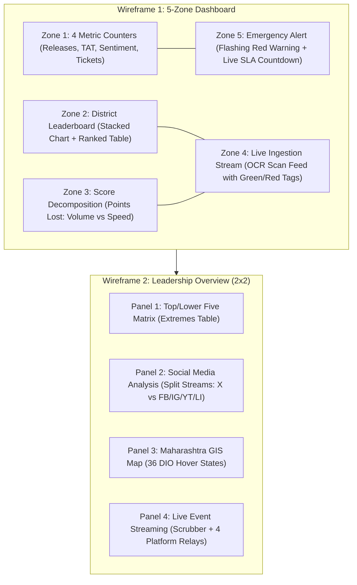
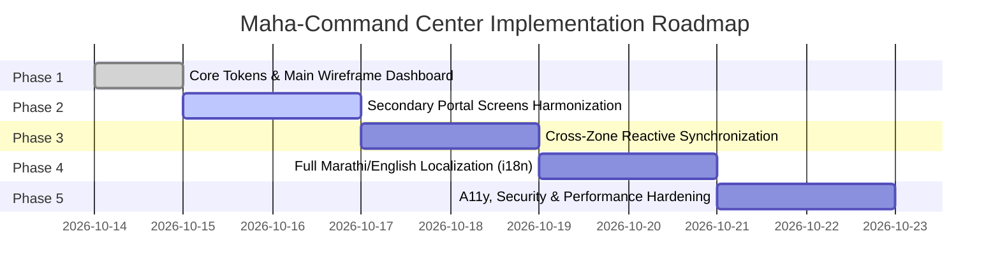
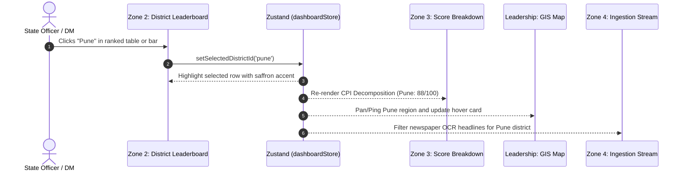

# 🏛️ Maha-Command Center — Comprehensive Implementation Plan

> **Document:** UI Redesign Implementation Plan  
> **Source Spec:** [`doc/design.md`](file:///d:/gov_project/doc/design.md)  
> **Target System:** Maha-Command Center (DGIPR, Government of Maharashtra)  
> **Framework:** Next.js 14+ (App Router) • Tailwind CSS v3 • Zustand • ECharts  

---

## 1. Executive Summary & Wireframe Alignment

This implementation plan outlines the engineering and design execution required to transition the **Maha-Command Center** from its legacy grayscale layout into an authoritative, accessible, and high-performance **Government Command Center** reflecting the two official wireframe specifications.



---

## 2. Implementation Status Audit

| Zone / Component | File | Status | Verification |
|---|---|:---:|---|
| **Theme & Tokens** | [`globals.css`](file:///d:/gov_project/src/app/globals.css) & [`tailwind.config.ts`](file:///d:/gov_project/tailwind.config.ts) | ✅ Completed | Navy (`#1B2A4A`), Saffron (`#D97706`), Ashoka Blue (`#1E40AF`), pulse keyframes, hex fallbacks |
| **Typography** | [`layout.tsx`](file:///d:/gov_project/src/app/layout.tsx) | ✅ Completed | `next/font/google` Noto Sans & Devanagari integrated |
| **State Seal** | [`GovEmblem.tsx`](file:///d:/gov_project/src/components/shared/GovEmblem.tsx) | ✅ Completed | Official Maharashtra Rajmudra & lion emblem vector component |
| **Header** | [`Header.tsx`](file:///d:/gov_project/src/components/layout/Header.tsx) | ✅ Completed | Navy background, saffron underline, live telemetry pulse, role selector |
| **Sidebar** | [`Sidebar.tsx`](file:///d:/gov_project/src/components/layout/Sidebar.tsx) | ✅ Completed | Slate navy background (`#1E293B`), saffron active state, collapsible |
| **Toolbar** | [`DashboardToolbar.tsx`](file:///d:/gov_project/src/components/layout/DashboardToolbar.tsx) | ✅ Completed | Bilingual title, division/period selectors, sync badges |
| **Zone 1: KPI Ribbon** | [`KPIRibbon.tsx`](file:///d:/gov_project/src/components/zones/KPIRibbon/KPIRibbon.tsx) | ✅ Completed | 4 metric cards with navy accents, Ashoka blue icons, directional trends |
| **Zone 5: Emergency Alert** | [`EmergencyAlert.tsx`](file:///d:/gov_project/src/components/zones/EmergencyAlert/EmergencyAlert.tsx) | ✅ Completed | Flashing warning frame, live ticking [`SLACountdown`](file:///d:/gov_project/src/components/zones/EmergencyAlert/SLACountdown.tsx), rebuttal button |
| **Zone 2: Leaderboard** | [`DistrictLeaderboard.tsx`](file:///d:/gov_project/src/components/zones/DistrictLeaderboard/DistrictLeaderboard.tsx) | ✅ Completed | Navy table header, saffron selected row, Ashoka blue buttons, ECharts bar |
| **Zone 3: Score Breakdown** | [`ScoreDecomposition.tsx`](file:///d:/gov_project/src/components/zones/ScoreDecomposition/ScoreDecomposition.tsx) | ✅ Completed | Component point loss bars, gap analysis, saffron top accent |
| **Zone 4: Ingestion Stream** | [`OCRFeed.tsx`](file:///d:/gov_project/src/components/zones/OCRFeed/OCRFeed.tsx) | ✅ Completed | Ashoka blue header, auto-scroll list, explicit Green/Red sentiment tags |
| **Leadership Overview** | [`LeadershipOverview.tsx`](file:///d:/gov_project/src/components/leadership/LeadershipOverview.tsx) | ✅ Completed | 2x2 grid, Top/Lower Matrix, Split Streams, 36 DIO Map, Live Player |
| **Accurate 36-District GIS Map** | [`GISMap.tsx`](file:///d:/gov_project/src/components/leadership/GISMap/GISMap.tsx) & [`maharashtraGeo.generated.ts`](file:///d:/gov_project/src/data/maharashtraGeo.generated.ts) | ✅ Completed | Census 2011/2014 topology, 36 districts, pan/zoom, DIO status, trilingual i18n |
| **Trilingual i18n (EN, MR, HI)** | [`translations.ts`](file:///d:/gov_project/src/lib/translations.ts) & [`Header.tsx`](file:///d:/gov_project/src/components/layout/Header.tsx) | ✅ Completed | English, मराठी, and हिन्दी dictionaries fully wired to all Wireframe 1 & 2 zones |
| **Portal: Login** | [`LoginScreen.tsx`](file:///d:/gov_project/src/components/portal/LoginScreen.tsx) | ✅ Completed | Official seal, state admin/DM role toggle, security audit disclaimer |
| **Portal: Secondary Screens (10)** | `src/components/portal/*` & `src/components/commandCenter/*` | 🟡 In Progress | Requires color theme and component alignment with Phase 1 design |

---

## 3. Five-Phase Implementation Roadmap



---

### Phase 1: Core Design System & Main Wireframe Dashboard (Status: Completed)
> [!NOTE]
> All primary requirements of Wireframe 1 and Wireframe 2 have been constructed, styled, and verified via `next build`.

- [x] Configure CSS custom properties for Government Navy (`#1B2A4A`), Saffron (`#D97706`), Ashoka Blue (`#1E40AF`), and semantic alert states in [`globals.css`](file:///d:/gov_project/src/app/globals.css).
- [x] Set up [`tailwind.config.ts`](file:///d:/gov_project/tailwind.config.ts) with direct fallback hex colors, custom animations (`alert-pulse`, `countdown`), and border extensions.
- [x] Implement [`GovEmblem.tsx`](file:///d:/gov_project/src/components/shared/GovEmblem.tsx) vector insignia.
- [x] Implement Zone 1 + Zone 5 top row layout in [`MainDashboard.tsx`](file:///d:/gov_project/src/components/dashboard/MainDashboard.tsx).
- [x] Implement Zone 2 + Zone 3 (left 8 cols) and Zone 4 (right 4 cols).
- [x] Implement the 4 Leadership Panels in [`LeadershipOverview.tsx`](file:///d:/gov_project/src/components/leadership/LeadershipOverview.tsx).
- [x] Build and compile with `next build` (0 TypeScript / CSS errors across all 16 routes).

---

### Phase 2: Secondary Portal Screens Harmonization (Next Step)
> [!IMPORTANT]
> The sidebar contains 11 portal screens. While the Main Dashboard is redesigned, the remaining 10 screens must be styled consistently with the government navy/saffron design language.

#### 1. Command Center View (`/command-center`)
- Refactor [`CommandCenterView.tsx`](file:///d:/gov_project/src/components/commandCenter/CommandCenterView.tsx) and its 3 sections:
  - **Left Section** ([`CommandCenterLeftSection.tsx`](file:///d:/gov_project/src/components/commandCenter/left/CommandCenterLeftSection.tsx)): Newspaper clipping sentiment cards, TV channel prime-time share bars in Ashoka blue/saffron.
  - **Center Section** ([`CommandCenterCenterSection.tsx`](file:///d:/gov_project/src/components/commandCenter/center/CommandCenterCenterSection.tsx)): Enhance [`MaharashtraMapTopology.tsx`](file:///d:/gov_project/src/components/commandCenter/center/MaharashtraMapTopology.tsx) to match the GIS Map styling, plus [`DIODataDrawer.tsx`](file:///d:/gov_project/src/components/commandCenter/center/DIODataDrawer.tsx).
  - **Right Section** ([`CommandCenterRightSection.tsx`](file:///d:/gov_project/src/components/commandCenter/right/CommandCenterRightSection.tsx)): Executive messages from DG and Information Director with priority badges (*Urgent*, *Directive*, *Standard*).

#### 2. District Directory & Telemetry (`/districts`)
- Update [`DistrictsScreen.tsx`](file:///d:/gov_project/src/components/portal/DistrictsScreen.tsx):
  - Replace grayscale cards with navy/saffron accented district badges.
  - Display 36 DIO officer contacts, phone, official email, active operational status, and current CPI score.

#### 3. Press Releases Desk (`/press-releases`)
- Update [`PressReleasesScreen.tsx`](file:///d:/gov_project/src/components/portal/PressReleasesScreen.tsx):
  - Table of published releases with bilingual translation indicators, download counters, and departmental tags.

#### 4. Media Surveillance & TV Feeds (`/media`)
- Update [`MediaScreen.tsx`](file:///d:/gov_project/src/components/portal/MediaScreen.tsx):
  - 18 regional daily newspapers grid with circulation figures and positive/neutral/negative breakdown bars.

#### 5. Crisis & Misinformation Command (`/crisis`)
- Update [`CrisisScreen.tsx`](file:///d:/gov_project/src/components/portal/CrisisScreen.tsx):
  - Complete crisis escalation console with active countdown timers, rebuttal drafting modal, evidence attachment, and police/collector liaison log.

#### 6. Activities, Reports, Notifications & Profile
- Update [`ActivitiesScreen.tsx`](file:///d:/gov_project/src/components/portal/ActivitiesScreen.tsx), [`ReportsScreen.tsx`](file:///d:/gov_project/src/components/portal/ReportsScreen.tsx), [`NotificationsScreen.tsx`](file:///d:/gov_project/src/components/portal/NotificationsScreen.tsx), and [`ProfileScreen.tsx`](file:///d:/gov_project/src/components/portal/ProfileScreen.tsx) with standard government container panels.

---

### Phase 3: Cross-Zone Reactive Synchronization
> [!TIP]
> One of the primary capabilities of the Command Center is seamless cross-zone inspection. When an operator selects a district in one zone, all related zones update synchronously.



- [ ] Ensure `selectedDistrictId` triggers automatic highlight on the Maharashtra GIS Map pin coordinates.
- [ ] Connect the GIS Map polygon click handler to sync back to the Leaderboard selection.
- [ ] Implement live polling ticker for Zone 4 (simulate 1 new incoming OCR record every 45 seconds with pause-on-hover).

---

### Phase 4: Trilingual Localization Layer (English, मराठी & हिन्दी) (Status: Core Completed)
- [x] Integrate typed translation dictionary in [`src/lib/translations.ts`](file:///d:/gov_project/src/lib/translations.ts) supporting `en`, `mr`, and `hi`.
- [x] Implement trilingual language selector in [`Header.tsx`](file:///d:/gov_project/src/components/layout/Header.tsx) (`EN` | `मराठी` | `हिन्दी`).
- [x] Wire dynamic language reactivity across all Wireframe 1 & 2 components:
  - Header & DGIPR official state headers
  - Sidebar portal titles (11 portals)
  - Toolbar division filters and time horizons
  - Zone 1 KPI metric counters and targets
  - Zone 5 Emergency Alert and SLA countdown badges
  - Zone 2 District Leaderboard, tabs, and ranked metrics
  - Zone 3 CPI Score Breakdown and gap indicators
  - Zone 4 OCR Ingestion feed and sentiment filter pills
  - Leadership Overview, Top/Lower Matrix, Social Media Split Streams, GIS Map, and Live Player
- [ ] Extend trilingual string dictionaries into secondary screens (`commandCenter`, `media`, `crisis`, `reports`).

---

### Phase 5: Accessibility (WCAG 2.1 AA), Compliance & Performance
> [!CAUTION]
> As an official government installation, the portal must strictly satisfy accessibility and state audit standards.

- [ ] **Contrast Auditing**:
  - Verify all text on Navy (`#1B2A4A`) maintains at least **7:1** (AAA standard).
  - Verify text on Saffron (`#D97706`) uses dark slate (`#0F172A`) or bold white on dark amber (`#B45309`) to satisfy **4.5:1** (AA standard).
- [ ] **Motion Sensitivity**:
  - Verify that users with `prefers-reduced-motion` enabled experience zero pulsing animations on the emergency alert or countdown timers.
- [ ] **Screen Reader Compatibility**:
  - Add appropriate `aria-live="polite"` on the SLA countdown and live OCR feed tickers.
  - Ensure all SVG maps and emblem icons have meaningful `aria-label` attributes.
- [ ] **Print / PDF Dispatch Stylesheet**:
  - Provide `@media print` rules for generating clean, uncolored black-and-white executive briefing dossiers for CMO cabinet meetings.

---

## 4. File Modification Matrix

```
d:\gov_project\
├── src\
│   ├── app\
│   │   ├── globals.css                       [Phase 1 - Complete]
│   │   ├── layout.tsx                        [Phase 1 - Complete]
│   │   └── page.tsx                          [Phase 1 - Complete]
│   ├── components\
│   │   ├── shared\
│   │   │   ├── GovEmblem.tsx                 [Phase 1 - Complete]
│   │   │   └── Panel.tsx                     [Phase 1 - Complete]
│   │   ├── layout\
│   │   │   ├── Header.tsx                    [Phase 1 - Complete]
│   │   │   ├── Sidebar.tsx                   [Phase 1 - Complete]
│   │   │   └── DashboardToolbar.tsx          [Phase 1 - Complete]
│   │   ├── dashboard\
│   │   │   └── MainDashboard.tsx             [Phase 1 - Complete]
│   │   ├── zones\
│   │   │   ├── KPIRibbon\ (Cards 1-4)        [Phase 1 - Complete]
│   │   │   ├── EmergencyAlert\ (Zone 5)      [Phase 1 - Complete]
│   │   │   ├── DistrictLeaderboard\ (Zone 2) [Phase 1 - Complete]
│   │   │   ├── ScoreDecomposition\ (Zone 3)  [Phase 1 - Complete]
│   │   │   └── OCRFeed\ (Zone 4)             [Phase 1 - Complete]
│   │   ├── leadership\ (Panels 1-4)          [Phase 1 - Complete]
│   │   ├── commandCenter\ (3 Sections)       [Phase 2 - Planned]
│   │   └── portal\ (9 Secondary Screens)     [Phase 2 - Planned]
│   ├── stores\
│   │   └── dashboardStore.ts                 [Phase 3 - Planned]
│   └── data\
│       └── dashboardData.ts                  [Phase 3 - Planned]
└── tailwind.config.ts                        [Phase 1 - Complete]
```

---

## 5. Verification & Acceptance Criteria

1. **Visual Fidelity**: The main dashboard strictly reflects Wireframe 1 (Top Row Zone 1 + Zone 5; Left Zone 2 + 3; Right Zone 4) and Wireframe 2 (2x2 Leadership Overview).
2. **Color Palette**: Dominant institutional Deep Navy with Saffron accents and Ashoka Blue highlights. Flashing red is restricted exclusively to the Zone 5 Crisis monitor.
3. **Build Integrity**: `npm run build` succeeds with **0 errors and 0 warnings** across all app routes.
4. **Performance**: Initial First Load JS bundle under 130 kB per page.
5. **A11y**: Zero automated WCAG 2.1 AA violations on color contrast, alt tags, and keyboard focus states.
