# Maha-Command Center: Principal Frontend Audit and UI Refinement Implementation Plan

**Authority**: Directorate General of Information and Public Relations (DGIPR), Government of Maharashtra  
**System Classification**: State Information Operations & Crisis Command Center Portal  
**Document Author**: Principal UI/UX Designer, Senior Frontend Architect, Accessibility Engineer & Frontend Performance Specialist  
**Deliverable**: `implementation_plan.md` (Project Root)  
**Status**: Strict Audit & Planning Phase (Zero Code Changes Permitted)  
**Date**: October 2026  

---

## Section 1: Executive Summary

### 1.1 Overview and Purpose
This document provides a precise, evidence-based, file-specific implementation plan for refining the **Maha-Command Center** into a professional, minimal, low-cognitive-load, responsive enterprise government portal. The audit covers the entire Next.js 14 App Router codebase across all 11 operational routes, 44 icon-consuming components, and data-dense operational workspaces.

The objective is to eliminate visual clutter, eliminate leftover AI-generated wireframe artifacts (such as artificial zone badges, card numbering, and arbitrary Unicode symbols), streamline information density across all KPI and status cards, standardize all icons on official **Google Material SVG assets** through a centralized, zero-dependency SVG architecture, eliminate distracting looping animations, and harden keyboard accessibility and responsive behavior across all viewports (320px–1440px+).

### 1.2 Significant Verified UI Problems
1. **Leftover Wireframe Artifacts & Artificial Badges**:
   - Multiple core dashboard sections carry literal wireframe labels (e.g. `ZONE 1` in `KPIRibbon.tsx`, `ZONE 3` in `ScoreDecomposition.tsx`, `ZONE 4` in `OCRFeed.tsx`, `ZONE 5` in `EmergencyAlert.tsx`).
   - Cards in the Command Center and Department workspaces display raw numbered titles (e.g., `1. Newspaper Data...`, `2. TV Channel...`, `3. Social Media...`, `1. Official Press Releases`, `2. Event Photographs...`, `3. Official Videos...`, `4. Government Resolutions...`). These numbered prefixes reflect scaffolding rather than production enterprise IA.
2. **Icon Fragmentation & Missing Centralization**:
   - Exactly **168 Lucide React icon imports** across **44 component files** representing **73 unique icon names** are scattered across the codebase.
   - Icons are imported directly with inconsistent sizing (`w-3`, `w-3.5`, `w-4`, `w-5`, `w-8`), variable stroke widths, and lacking accessible names when used as standalone action triggers.
3. **Arbitrary Unicode Characters Used in Place of UI Components**:
   - Inline text strings contain arbitrary Unicode bullets and symbols: `●` in `DIODataDrawer.tsx`, `▲` in `SocialMediaDataSection.tsx`, `●` in `LeadershipMessagesSection.tsx`, `●` in `LiveStreaming.tsx`, and `✓` in `ProfileScreen.tsx`.
4. **Distracting & Non-Compliant Motion**:
   - Continuous looping animations (`animate-ping`, `animate-pulse`, `animate-spin`, `animate-alert-pulse`, `animate-countdown`) run continuously on badges, icons, and status indicators without user control.
   - Multiple modal components apply `animate-fadeIn`, an undefined utility in `tailwind.config.ts`.
5. **Overloaded Information Density in Compact Cards**:
   - Compact cards frequently display 4–6 metadata items (e.g. internal hash IDs, confidence scores, multiple timestamps, redundant status tags) that crowd out the primary metric and increase cognitive load.
6. **Accessibility & Interactive Semantics Deficiencies**:
   - Sortable table headers in `DistrictTable.tsx` lack `aria-sort` attributes.
   - Icon-only buttons (such as PDF download triggers and refresh buttons) lack `aria-label` attributes for screen readers.
   - Interactive list rows in `NotificationsScreen.tsx` rely on click handlers on `<div>` elements without keyboard interaction handling (`onKeyDown`, `role="button"`, `tabIndex={0}`).

### 1.3 Proposed Visual Direction
- **Low Cognitive Load**: Establish clean, calm, authoritative visual hierarchy with intentional whitespace, standardized 4px grid spacing, and strict suppression of decorative elements.
- **Card Simplification**: Enforce a strict card structure: (1) short descriptive title, (2) primary metric/status in high-contrast tabular typography, and (3) a single supporting context badge or label only where essential.
- **Centralized Google Material SVG Architecture**: A typed, zero-dependency `MaterialIcon` registry rendering official Google Material SVG paths directly, standardizing icons at 16px, 20px, and 24px with accessible labeling and full support for `currentColor`.
- **Motion-Minimal Default**: Default to completely static UI. Retain only subtle, purposeful transitions (120–200ms) for modal overlays and drawer slides, respecting `prefers-reduced-motion`.

### 1.4 Major Implementation & Regression Risks
- **Visual Regression During Icon Migration**: Replacing 168 icon imports could introduce layout shifts if SVG bounding boxes or viewBoxes differ from Lucide React dimensions.
- **State Coupling in Card Simplification**: Removing secondary metadata from cards must not break underlying store interactions (e.g. selected district IDs, verification status).
- **Table Keyboard Accessibility**: Adding keyboard handlers to table headers and rows must preserve existing multi-column sorting and pagination states.
- **Language Localization Integrity**: Simplifying card copy must preserve full bilingual/trilingual parity across English (`en`), Marathi (`mr`), and Hindi (`hi`).

---

## Section 2: Verified Project Structure

The frontend is built on **Next.js 14.2.35 (App Router)**, **TypeScript 5 (Strict Mode)**, **Tailwind CSS 3.4.1**, and **Zustand 5.0.15**.

```
d:\gov_project\
├── package.json
├── tsconfig.json
├── tailwind.config.ts
├── next.config.mjs
├── .eslintrc.json
├── changes.md
├── scripts/
│   └── build-maharashtra-geo.mjs          # 36-district GIS GeoJSON generator
└── src/
    ├── app/
    │   ├── layout.tsx                     # Root HTML & Font definitions
    │   ├── globals.css                    # Design tokens & CSS custom properties
    │   ├── not-found.tsx                  # Global 404 handler
    │   ├── page.tsx                       # Redirect / root landing
    │   ├── activities/page.tsx            # Operational Activities Route
    │   ├── command-center/page.tsx        # 3-Column Command Center Route
    │   ├── crisis/page.tsx                # Crisis Escalation Desk Route
    │   ├── dashboard/page.tsx             # Executive Cockpit Route
    │   ├── districts/page.tsx             # 36-District Matrix Route
    │   ├── login/page.tsx                 # Clearance Gateway Route
    │   ├── media/page.tsx                 # Media Vault Route
    │   ├── notifications/page.tsx         # Notification Center Route
    │   ├── press-releases/page.tsx        # Press Releases Route
    │   ├── profile/page.tsx               # Officer Profile Route
    │   └── reports/page.tsx               # Executive Reports Route
    ├── components/
    │   ├── layout/
    │   │   ├── DashboardLayout.tsx        # App Shell: Header + Nav + Content
    │   │   ├── DashboardToolbar.tsx       # Division & Period Filters
    │   │   ├── Header.tsx                 # Branding, Telemetry, Role, Language
    │   │   └── Sidebar.tsx                # Responsive Navigation Drawer
    │   ├── dashboard/
    │   │   ├── MainDashboard.tsx          # Zone Orchestrator
    │   │   ├── OperationsWorkspace.tsx    # Operational Workspace
    │   │   ├── DistrictOperationsColumn.tsx
    │   │   └── CrisisOperationsColumn.tsx
    │   ├── commandCenter/
    │   │   ├── CommandCenterView.tsx      # Triptych 3-Column Layout
    │   │   ├── left/
    │   │   │   ├── CommandCenterLeftSection.tsx
    │   │   │   ├── NewspaperDataSection.tsx
    │   │   │   ├── TVChannelDataSection.tsx
    │   │   │   └── SocialMediaDataSection.tsx
    │   │   ├── center/
    │   │   │   ├── CommandCenterCenterSection.tsx
    │   │   │   ├── MaharashtraMapTopology.tsx  # 36-District SVG Vector Map
    │   │   │   ├── DistrictSubHeadSelector.tsx # Division Tabs & District Selector
    │   │   │   └── DIODataDrawer.tsx           # DIO Telemetry Inspection Drawer
    │   │   └── right/
    │   │       ├── CommandCenterRightSection.tsx
    │   │       ├── LeadershipMessagesSection.tsx
    │   │       └── LiveStreamingLinkSection.tsx
    │   ├── zones/
    │   │   ├── KPIRibbon/
    │   │   │   ├── KPIRibbon.tsx          # Zone 1 Statewide Aggregates
    │   │   │   └── KPICard.tsx            # Primary KPI Metric Card
    │   │   ├── DistrictLeaderboard/
    │   │   │   ├── DistrictLeaderboard.tsx# Zone 2 Container
    │   │   │   ├── DistrictTable.tsx      # Sortable 36-District Table
    │   │   │   ├── DistrictSearchBar.tsx  # Search Input
    │   │   │   ├── DistrictPerformanceChart.tsx # ECharts Bar Chart
    │   │   │   └── LeaderboardTabs.tsx    # Filter Tabs
    │   │   ├── ScoreDecomposition/
    │   │   │   ├── ScoreDecomposition.tsx # Zone 3 CPI Breakdown
    │   │   │   └── ScoreMetricBar.tsx     # Constituent Metric Progress Bar
    │   │   ├── OCRFeed/
    │   │   │   ├── OCRFeed.tsx            # Zone 4 Live News Ticker
    │   │   │   ├── OCRFeedItem.tsx        # News Clipping Card
    │   │   │   └── OCRFilterPills.tsx     # Sentiment / Media Filters
    │   │   └── EmergencyAlert/
    │   │       ├── EmergencyAlert.tsx     # Zone 5 Alert Header & Container
    │   │       ├── PrimaryIncidentCard.tsx# Active SLA Incident with Drawers
    │   │       ├── SLACountdown.tsx       # 90-Minute Numeric Countdown
    │   │       └── IncidentList.tsx       # Secondary Threat Feed
    │   ├── leadership/
    │   │   ├── LeadershipOverview.tsx     # 2x2 Leadership Grid
    │   │   ├── TopLowerMatrix/TopLowerMatrix.tsx
    │   │   ├── SocialMediaAnalysis/SocialMediaAnalysis.tsx
    │   │   ├── GISMap/GISMap.tsx          # Interactive Pan/Zoom Map
    │   │   └── LiveStreaming/LiveStreaming.tsx
    │   ├── departments/
    │   │   ├── DepartmentWiseDataView.tsx # Department Container
    │   │   ├── DepartmentSelector.tsx     # Department Switcher
    │   │   ├── DepartmentPressReleases.tsx# Press Release List
    │   │   ├── DepartmentPhotographs.tsx  # Photo Grid
    │   │   ├── DepartmentVideos.tsx       # Video Clips
    │   │   ├── DepartmentSocialAnalysis.tsx
    │   │   └── DepartmentEmptySlot.tsx    # Gazette & Archival Vault
    │   ├── workflow/
    │   │   ├── DailyWorkFlowchart.tsx     # 24h Lifecycle Stepper
    │   │   └── WorkflowStepCard.tsx       # Stage Checkpoint Card
    │   ├── portal/
    │   │   ├── ActivitiesScreen.tsx       # VIP Itinerary & Events
    │   │   ├── CrisisScreen.tsx           # Crisis Command Desk
    │   │   ├── DistrictsScreen.tsx        # Districts Admin Desk
    │   │   ├── LoginScreen.tsx            # Authentication Gate
    │   │   ├── MediaScreen.tsx            # Media Vault View
    │   │   ├── NotificationsScreen.tsx    # Notifications & Dossiers
    │   │   ├── PressReleasesScreen.tsx    # PR Dispatch & Drafting
    │   │   ├── ProfileScreen.tsx          # Officer Clearance Profile
    │   │   └── ReportsScreen.tsx          # Executive Dossier Generator
    │   ├── shared/
    │   │   ├── GovEmblem.tsx              # Official Maharashtra Seal
    │   │   └── Panel.tsx                  # Standard Bordered Frame
    │   └── notFound/
    │       ├── NotFoundDisplay.tsx
    │       ├── NotFoundMessage.tsx
    │       └── NotFoundActions.tsx
    ├── data/
    │   ├── dashboardData.ts               # Core State Entities & Metrics
    │   ├── dioDirectory.ts                # 36 District Information Officers
    │   └── maharashtraGeo.generated.ts    # Precise 36-District SVG Geometries
    ├── lib/
    │   └── translations.ts                # Tri-lingual Localization Dictionary
    ├── stores/
    │   └── dashboardStore.ts              # Zustand 5 Global State Store
    └── types/
        └── dashboard.ts                   # Strict TypeScript Interfaces
```

---

## Section 3: Module Dependency and Component Relationship Map

```mermaid
flowchart TD
    subgraph CoreEngine["Application Core & State Engine"]
        Layout["Root Layout (app/layout.tsx)"]
        Globals["Tokens (globals.css)"]
        Store["Zustand Store (stores/dashboardStore.ts)"]
        Translations["Localization (lib/translations.ts)"]
        GeoData["GIS Cartography (data/maharashtraGeo.generated.ts)"]
        Data["State Entities (data/dashboardData.ts)"]
    end

    subgraph Shell["Global Application Shell"]
        DashLayout["DashboardLayout.tsx"]
        Header["Header.tsx"]
        Sidebar["Sidebar.tsx"]
        Toolbar["DashboardToolbar.tsx"]
    end

    subgraph Pages["Portal Routes (app/*)"]
        R_Root["/ & /dashboard"]
        R_Cmd["/command-center"]
        R_Dist["/districts"]
        R_PR["/press-releases"]
        R_Media["/media"]
        R_Act["/activities"]
        R_Crisis["/crisis"]
        R_Rep["/reports"]
        R_Notif["/notifications"]
        R_Prof["/profile"]
        R_Log["/login"]
    end

    subgraph KeyComponents["Feature Modules & Workspaces"]
        MainDash["MainDashboard.tsx"]
        KPIRibbon["KPIRibbon.tsx"]
        DistrictTable["DistrictTable.tsx"]
        ScoreDecomp["ScoreDecomposition.tsx"]
        OCRFeed["OCRFeed.tsx"]
        EmergencyAlert["EmergencyAlert.tsx"]
        CmdDeck["CommandCenterView.tsx"]
        MapTopology["MaharashtraMapTopology.tsx"]
        SubHeadSelect["DistrictSubHeadSelector.tsx"]
        DIODrawer["DIODataDrawer.tsx"]
        Workflow["DailyWorkFlowchart.tsx"]
        DeptVault["DepartmentEmptySlot.tsx"]
    end

    subgraph TargetIcon["Target Shared Component"]
        MaterialIcon["MaterialIcon.tsx (Google SVG Assets)"]
    end

    %% Dependency Connections
    Layout --> Globals
    Layout --> DashLayout
    DashLayout --> Header
    DashLayout --> Sidebar
    DashLayout --> Toolbar

    Store --> Data
    Store --> Translations
    Translations --> Header
    Translations --> Sidebar
    Translations --> Toolbar

    DashLayout --> R_Root
    DashLayout --> R_Cmd
    DashLayout --> R_Dist
    DashLayout --> R_PR
    DashLayout --> R_Media
    DashLayout --> R_Act
    DashLayout --> R_Crisis
    DashLayout --> R_Rep
    DashLayout --> R_Notif
    DashLayout --> R_Prof
    DashLayout --> R_Log

    R_Root --> MainDash
    MainDash --> KPIRibbon
    MainDash --> DistrictTable
    MainDash --> ScoreDecomp
    MainDash --> OCRFeed
    MainDash --> EmergencyAlert

    R_Cmd --> CmdDeck
    CmdDeck --> MapTopology
    CmdDeck --> SubHeadSelect
    CmdDeck --> DIODrawer
    MapTopology --> GeoData

    R_Act --> Workflow
    R_Crisis --> EmergencyAlert

    %% Icon System Connections
    Header -.-> MaterialIcon
    Sidebar -.-> MaterialIcon
    Toolbar -.-> MaterialIcon
    KPIRibbon -.-> MaterialIcon
    DistrictTable -.-> MaterialIcon
    ScoreDecomp -.-> MaterialIcon
    OCRFeed -.-> MaterialIcon
    EmergencyAlert -.-> MaterialIcon
    CmdDeck -.-> MaterialIcon
    Workflow -.-> MaterialIcon
    DeptVault -.-> MaterialIcon
```



---

## Section 4: Verified UI Audit Findings

| ID | File or Component | Verified Issue | Required Change | Priority |
|---|---|---|---|---|
| **AUD-001** | `src/components/zones/KPIRibbon/KPIRibbon.tsx` | Displays wireframe leftover badge `ZONE 1` (`t.zone1.zoneLabel`) in header. | Remove `ZONE 1` badge; elevate section title `Statewide Key Performance Indicators` with clean typography. | **P1** |
| **AUD-002** | `src/components/zones/KPIRibbon/KPICard.tsx` | Thick decorative accent border `border-l-4 border-l-gov-primary` and hover shadow jump `hover:shadow-md`. | Replace with standard subtle border `border-slate-200`; eliminate hover shadow jumping; simplify card hierarchy to title, metric, and target pill. | **P1** |
| **AUD-003** | `src/components/zones/ScoreDecomposition/ScoreDecomposition.tsx` | Displays wireframe leftover badge `ZONE 3` (`t.zone3.zoneLabel`) and colored top stripe `border-t-4 border-t-gov-accent`. | Remove `ZONE 3` badge and top colored border; standardize to uniform 1px institutional border. | **P1** |
| **AUD-004** | `src/components/zones/OCRFeed/OCRFeed.tsx` | Displays wireframe leftover badge `ZONE 4` (`t.zone4.zoneLabel`) and continuous looping `animate-pulse` on green live dot. | Remove `ZONE 4` badge; replace `animate-pulse` with a static green status dot. | **P1** |
| **AUD-005** | `src/components/zones/EmergencyAlert/EmergencyAlert.tsx` | Displays wireframe leftover badge `ZONE 5` (`t.zone5.zoneLabel`) and red top accent `border-t-4 border-t-red-700`. | Remove `ZONE 5` badge and top border stripe; use clean, authoritative 1px red-300 border and clean header typography. | **P1** |
| **AUD-006** | `src/components/commandCenter/left/NewspaperDataSection.tsx` | Numbered section heading `1. Newspaper Data & Print Clippings`. | Change title to `Newspaper Data & Print Clippings` (remove `1. ` prefix). | **P2** |
| **AUD-007** | `src/components/commandCenter/left/TVChannelDataSection.tsx` | Numbered section heading `2. TV Channel Broadcast Data`. | Change title to `TV Broadcast Monitoring` (remove `2. ` prefix). | **P2** |
| **AUD-008** | `src/components/commandCenter/left/SocialMediaDataSection.tsx` | Numbered section heading `3. Social Media Data Analysis` and inline Unicode triangle `▲ Peak Surge Alert`. | Remove `3. ` prefix; replace `▲` character with clean semantic SVG icon or badge. | **P2** |
| **AUD-009** | `src/components/departments/DepartmentPressReleases.tsx` | Numbered section heading `1. Official Press Releases`. | Change title to `Official Press Releases` (remove `1. ` prefix). | **P2** |
| **AUD-010** | `src/components/departments/DepartmentPhotographs.tsx` | Numbered section heading `2. Event Photographs Gallery`. | Change title to `Event Photographs` (remove `2. ` prefix). | **P2** |
| **AUD-011** | `src/components/departments/DepartmentVideos.tsx` | Numbered section heading `3. Official Videos & Documentaries`. | Change title to `Video Briefings & Coverage` (remove `3. ` prefix). | **P2** |
| **AUD-012** | `src/components/departments/DepartmentEmptySlot.tsx` | Numbered section heading `4. Government Resolutions (GR) & Gazette Archival Vault`. | Change title to `Gazette & Resolution Vault` (remove `4. ` prefix). | **P2** |
| **AUD-013** | `src/components/commandCenter/center/DIODataDrawer.tsx` | Raw Unicode black circle `● {dioInfo.localAlerts} Active` used as bullet indicator. | Replace raw Unicode `●` with accessible status indicator `<span className="w-1.5 h-1.5 rounded-full bg-red-600 inline-block mr-1" />`. | **P2** |
| **AUD-014** | `src/components/commandCenter/right/LeadershipMessagesSection.tsx` | Raw Unicode black circle `● {msg.priority}` in message header. | Replace raw `●` with structured priority badge element. | **P2** |
| **AUD-015** | `src/components/leadership/LiveStreaming/LiveStreaming.tsx` | Raw Unicode black circle `● {chan.label}` and continuous looping `animate-ping` on live dot. | Replace raw `●` with SVG broadcast icon; remove `animate-ping` in favor of a calm static indicator. | **P1** |
| **AUD-016** | `src/components/portal/ProfileScreen.tsx` | Raw Unicode checkmark character `✓` in save button text (`'Preferences Saved ✓'`). | Replace Unicode character with Google Material SVG checkmark icon. | **P2** |
| **AUD-017** | `src/components/layout/Header.tsx` | Continuous looping `animate-ping` on live telemetry dot; colored bottom border stripe `border-b-2 border-gov-accent`. | Remove `animate-ping` (retain static emerald indicator); standardize border to clean subtle line. | **P1** |
| **AUD-018** | `src/components/zones/EmergencyAlert/SLACountdown.tsx` | Looping `animate-pulse` on countdown clock icon when `isCritical` is true. | Remove `animate-pulse`; convey urgency via solid high-contrast crimson text and accessible aria labels. | **P1** |
| **AUD-019** | `src/components/zones/DistrictLeaderboard/DistrictTable.tsx` | Sortable `<th>` column headers lack `aria-sort` and accessible sort descriptions. | Add `aria-sort={sortColumn === col ? (sortOrder === 'asc' ? 'ascending' : 'descending') : 'none'}` to all 8 sortable headers. | **P0** |
| **AUD-020** | `src/components/zones/DistrictLeaderboard/DistrictTable.tsx` | "Inspect" button (`ArrowUpRight`) lacks explicit `aria-label`. | Add `aria-label={`Inspect ${d.name} performance metrics and CPI decomposition`}`. | **P1** |
| **AUD-021** | `src/components/portal/NotificationsScreen.tsx` | Notification list item `div` has `onClick` but lacks `role="button"`, `tabIndex={0}`, and `onKeyDown`. | Add semantic attributes and keyboard handler (Enter / Space) to ensure full keyboard navigation. | **P0** |
| **AUD-022** | `src/components/portal/NotificationsScreen.tsx` | Review action modal uses undefined `animate-fadeIn` class. | Replace with standard CSS transition `transition-opacity duration-150`. | **P2** |
| **AUD-023** | `src/components/portal/PressReleasesScreen.tsx` | Draft modal uses undefined `animate-fadeIn` class. | Replace with standard CSS transition `transition-opacity duration-150`. | **P2** |
| **AUD-024** | `src/components/portal/ReportsScreen.tsx` | Generate dossier modal uses undefined `animate-fadeIn` class. | Replace with standard CSS transition `transition-opacity duration-150`. | **P2** |
| **AUD-025** | `src/components/zones/EmergencyAlert/PrimaryIncidentCard.tsx` | Expandable Evidence and Timeline drawers use undefined `animate-fadeIn` class. | Replace with CSS transition or static conditional render. | **P2** |
| **AUD-026** | `src/components/portal/CrisisScreen.tsx` | 3 top KPI summary cards display oversized 32px icons (`w-8 h-8`) and verbose secondary copy. | Standardize to concise cards: title, tabular metric, and short supporting label; normalize icon to 20px. | **P2** |
| **AUD-027** | `src/components/zones/OCRFeed/OCRFeedItem.tsx` | Displays redundant verbose strings `AI Conf: 92%` and `3.2s scan` and `Positive Sentiment`. | Simplify to `Confidence: 92%` and concise sentiment pill `Positive`. | **P2** |
| **AUD-028** | `src/components/portal/LoginScreen.tsx` | Decorative top stripe `border-t-4 border-t-gov-accent` and heavy `shadow-lg` container. | Standardize login card to clean 1px border and standard subtle shadow. | **P3** |

---

## Section 5: Card and Information-Density Simplification

### Card Inventory & Simplification Matrix

#### 1. Statewide KPI Card
- **File**: [`src/components/zones/KPIRibbon/KPICard.tsx`](file:///d:/gov_project/src/components/zones/KPIRibbon/KPICard.tsx)
- **Current Content**: Icon in blue rounded badge, Title, Marathi subtitle, primary number + unit, target text string (e.g. `Target: 1,000+ met`), trend direction arrow + percentage string. Left border accent `border-l-4 border-l-gov-primary`, hover shadow `hover:shadow-md`.
- **Primary Information to Retain**: Title, Primary metric value + unit, Target status pill, Trend arrow + value.
- **Secondary Information to Remove/Relocate**: Remove decorative blue icon container background; remove thick left border `border-l-4`; remove hover shadow transition.
- **Proposed Concise Structure**:
  - Title: `{title}` (e.g., `Total Dispatches`)
  - Primary Metric: `1,248` (24px tabular font)
  - Supporting Label: `Target: 1,000+` (text pill) | `↓ 12% vs last week`
- **Responsive Behavior**: 1 col (<640px), 2 cols (640px–1279px), 4 cols (1280px+).

#### 2. Primary Incident Alert Card
- **File**: [`src/components/zones/EmergencyAlert/PrimaryIncidentCard.tsx`](file:///d:/gov_project/src/components/zones/EmergencyAlert/PrimaryIncidentCard.tsx)
- **Current Content**: ID badge, Threat level pill, District name, Summary text, Source label, Verification status, Live countdown widget, Evidence toggle, Timeline toggle, Authorize button. Left accent `border-l-4 border-l-red-700`.
- **Primary Information to Retain**: Incident ID, District, Headline claim, Verification status, SLA countdown, Evidence/Timeline toggles, Authorize action.
- **Secondary Information to Remove/Relocate**: Remove `border-l-4` stripe; condense source metadata; streamline drawer animations.
- **Proposed Concise Structure**:
  - Header: `[INC-8841] Critical SLA — Nashik`
  - Body: Incident summary text
  - Status/Timer: `28:14 Remaining` | Status: `Pending Verification`
  - Action Row: `Evidence` | `Timeline` | `Authorize Rebuttal`

#### 3. Secondary Threat Incident Item
- **File**: [`src/components/zones/EmergencyAlert/IncidentList.tsx`](file:///d:/gov_project/src/components/zones/EmergencyAlert/IncidentList.tsx)
- **Current Content**: Severity tag, District, Summary text, Countdown timer, Direct link to `/crisis`.
- **Primary Information to Retain**: Severity badge, District, Summary snippet, Countdown timer.
- **Secondary Information to Remove/Relocate**: Condense spacing; reduce padding from `p-3` to `p-2.5`.
- **Proposed Concise Structure**:
  - Title: `[Moderate] Pune Collectorate`
  - Claim: Single-line truncated claim
  - Status: `45m SLA`

#### 4. OCR News Feed Clipping Card
- **File**: [`src/components/zones/OCRFeed/OCRFeedItem.tsx`](file:///d:/gov_project/src/components/zones/OCRFeed/OCRFeedItem.tsx)
- **Current Content**: Source badge, District pin, Timestamp, Headline text, Sentiment badge with dot, `AI Conf: 92%`, `3.2s scan`.
- **Primary Information to Retain**: Source name, District, Headline, Timestamp, Sentiment pill.
- **Secondary Information to Remove/Relocate**: Remove `AI Conf:` prefix (change to `92% match`); remove `scan` suffix.
- **Proposed Concise Structure**:
  - Header: `Sakal • Pune • 14:28`
  - Headline: Clean text, max 2 lines
  - Footer: `Positive` (pill) | `92% Conf`

#### 5. Score Decomposition Metric Bar
- **File**: [`src/components/zones/ScoreDecomposition/ScoreMetricBar.tsx`](file:///d:/gov_project/src/components/zones/ScoreDecomposition/ScoreMetricBar.tsx)
- **Current Content**: Icon in blue box, Title, Subtitle, Score value (`21 / 25`), Raw value label (`1,248 releases`), Gap label (`4 pts to top tier`), Progress bar.
- **Primary Information to Retain**: Title, Score / Max Score, Raw metric value, Progress bar.
- **Secondary Information to Remove/Relocate**: Remove blue icon badge; streamline gap label to `Gap: -4`.
- **Proposed Concise Structure**:
  - Row: Icon + Title | `21 / 25` | `1,248 releases` | `Gap: -4`
  - Track: 6px clean progress bar

#### 6. Daily Workflow Stage Card
- **File**: [`src/components/workflow/WorkflowStepCard.tsx`](file:///d:/gov_project/src/components/workflow/WorkflowStepCard.tsx)
- **Current Content**: Stage index badge (`01`), Shift pill, Status badge with pulse, Time range (`06:00 - 08:30 AM`), Title, Description, Owner, Metric.
- **Primary Information to Retain**: Stage number, Title, Time range, Status pill, Key metric.
- **Secondary Information to Remove/Relocate**: Truncate description to 1 line; move operational owner into active drill-down panel.
- **Proposed Concise Structure**:
  - Header: `01 • 06:00 - 08:30` | `Done`
  - Title: `Media Ingestion`
  - Metric: `1,420 Articles Indexed`

#### 7. Crisis Desk SLA Metric Card
- **File**: [`src/components/portal/CrisisScreen.tsx`](file:///d:/gov_project/src/components/portal/CrisisScreen.tsx)
- **Current Content**: 32px oversized Lucide icon, Title, 24px metric number, multi-word supporting sentence (`Refuted within target time`).
- **Primary Information to Retain**: Title, 24px metric, short supporting pill.
- **Secondary Information to Remove/Relocate**: Shrink icon from 32px to 20px; condense sentence to 2–3 words.
- **Proposed Concise Structure**:
  - Title: `90-Minute Crisis SLA`
  - Value: `94.2%`
  - Label: `Within Target`

#### 8. Newspaper Data Section Card
- **File**: [`src/components/commandCenter/left/NewspaperDataSection.tsx`](file:///d:/gov_project/src/components/commandCenter/left/NewspaperDataSection.tsx)
- **Current Content**: Title `1. Newspaper Data & Print Clippings`, Subtitle, Article count badge, ECharts horizontal stacked bar chart.
- **Primary Information to Retain**: Title `Newspaper Data & Print Clippings`, Count badge, Chart.
- **Secondary Information to Remove/Relocate**: Remove `1. ` prefix.

#### 9. TV Channel Broadcast Data Card
- **File**: [`src/components/commandCenter/left/TVChannelDataSection.tsx`](file:///d:/gov_project/src/components/commandCenter/left/TVChannelDataSection.tsx)
- **Current Content**: Title `2. TV Channel Broadcast Data`, Subtitle, Feed badge, ECharts airtime bar chart.
- **Primary Information to Retain**: Title `TV Broadcast Monitoring`, Channel count, Chart.
- **Secondary Information to Remove/Relocate**: Remove `2. ` prefix.

#### 10. Social Media Analysis Card
- **File**: [`src/components/commandCenter/left/SocialMediaDataSection.tsx`](file:///d:/gov_project/src/components/commandCenter/left/SocialMediaDataSection.tsx)
- **Current Content**: Title `3. Social Media Data Analysis`, Subtitle, Velocity metric, Area chart with `▲ Peak Surge Alert` tooltip.
- **Primary Information to Retain**: Title `Social Media Ingestion & Velocity`, Mentions metric, Chart.
- **Secondary Information to Remove/Relocate**: Remove `3. ` prefix; replace `▲` with clean text pill.

#### 11. District Sub-Head Selector Card
- **File**: [`src/components/commandCenter/center/DistrictSubHeadSelector.tsx`](file:///d:/gov_project/src/components/commandCenter/center/DistrictSubHeadSelector.tsx)
- **Current Content**: District name, Rank `#1`, Division name, CPI value.
- **Primary Information to Retain**: District name, Rank, Division, CPI score.
- **Secondary Information to Remove/Relocate**: Maintain current compact design; optimize border contrast.

#### 12. DIO Telemetry Inspection Drawer
- **File**: [`src/components/commandCenter/center/DIODataDrawer.tsx`](file:///d:/gov_project/src/components/commandCenter/center/DIODataDrawer.tsx)
- **Current Content**: Officer name, Division, Phone, Email, Last Sync, 3 metric boxes (`Releases`, `● 0 Active Alerts`, `CPI 88/100`), Query input, Dispatch button.
- **Primary Information to Retain**: Officer name, Contact details, Sync timestamp, Metric boxes, Query dispatch action.
- **Secondary Information to Remove/Relocate**: Remove raw Unicode `●` in alerts box; replace with structured badge.

#### 13. Leadership Directive Message Card
- **File**: [`src/components/commandCenter/right/LeadershipMessagesSection.tsx`](file:///d:/gov_project/src/components/commandCenter/right/LeadershipMessagesSection.tsx)
- **Current Content**: Sender badge, `● {priority}`, Time, Message body, Target department.
- **Primary Information to Retain**: Sender, Priority badge, Timestamp, Message body, Target.
- **Secondary Information to Remove/Relocate**: Remove raw `●`; render clean styled priority tag (`Urgent`, `Directive`).

#### 14. Live Broadcast Link Card
- **File**: [`src/components/commandCenter/right/LiveStreamingLinkSection.tsx`](file:///d:/gov_project/src/components/commandCenter/right/LiveStreamingLinkSection.tsx)
- **Current Content**: Title, Live timer, Channel source tabs, Audio VU meter, Signal resolution tag (`1080p`), Play/Pause, External verified link.
- **Primary Information to Retain**: All playback telemetry, VU meter, feed switcher, link.
- **Secondary Information to Remove/Relocate**: Retain all telemetry; standardize icons.

#### 15. Department Press Release Item Card
- **File**: [`src/components/departments/DepartmentPressReleases.tsx`](file:///d:/gov_project/src/components/departments/DepartmentPressReleases.tsx)
- **Current Content**: Section title `1. Official Press Releases`, ID badge, Status, Title, Date, Download count, Download button with spinner/check.
- **Primary Information to Retain**: PR ID, Title, Date, Download action.
- **Secondary Information to Remove/Relocate**: Remove `1. ` prefix from section title; consolidate download count into tooltip.

#### 16. Department Photograph Gallery Card
- **File**: [`src/components/departments/DepartmentPhotographs.tsx`](file:///d:/gov_project/src/components/departments/DepartmentPhotographs.tsx)
- **Current Content**: Section title `2. Event Photographs Gallery`, Photo preview box, Category tag, Title, Date, Photographer.
- **Primary Information to Retain**: Section title `Event Photographs`, Photo preview, Category, Title, Date.
- **Secondary Information to Remove/Relocate**: Remove `2. ` prefix from section title.

#### 17. Department Video Clip Card
- **File**: [`src/components/departments/DepartmentVideos.tsx`](file:///d:/gov_project/src/components/departments/DepartmentVideos.tsx)
- **Current Content**: Section title `3. Official Videos & Documentaries`, Video box with Play icon, Duration pill, Title, View count, Date.
- **Primary Information to Retain**: Section title `Video Briefings & Coverage`, Duration, Title, Views, Date.
- **Secondary Information to Remove/Relocate**: Remove `3. ` prefix from section title.

#### 18. Department Archival Vault Card
- **File**: [`src/components/departments/DepartmentEmptySlot.tsx`](file:///d:/gov_project/src/components/departments/DepartmentEmptySlot.tsx)
- **Current Content**: Section title `4. Government Resolutions (GR) & Gazette Archival Vault`, Category filter tabs, Search input, Document list item with Ref No, Category, Clearance, Title, Date, File size, Download button, Archive modal.
- **Primary Information to Retain**: Title `Gazette & Resolution Vault`, Filters, Search, Document rows, Archive button, Modal.
- **Secondary Information to Remove/Relocate**: Remove `4. ` prefix from section title.

#### 19. Government Activity Itinerary Card
- **File**: [`src/components/portal/ActivitiesScreen.tsx`](file:///d:/gov_project/src/components/portal/ActivitiesScreen.tsx)
- **Current Content**: Event time badge, Status pill (`Completed`, `Ongoing`, `Scheduled`), Title, Location, Minister name.
- **Primary Information to Retain**: Time, Status, Title, Location, Dignitary.
- **Secondary Information to Remove/Relocate**: Streamline card borders; standardize icon sizes to 16px.

#### 20. Operational Notification Card
- **File**: [`src/components/portal/NotificationsScreen.tsx`](file:///d:/gov_project/src/components/portal/NotificationsScreen.tsx)
- **Current Content**: Type icon, Urgent SLA tag, Unread dot, Title, Description, Timestamp, Source, "Review Action" button.
- **Primary Information to Retain**: Priority indicator, Title, Description snippet, Timestamp, Review button.
- **Secondary Information to Remove/Relocate**: Optimize unread dot contrast; ensure row is keyboard accessible.

#### 21. Executive Report Item Card
- **File**: [`src/components/portal/ReportsScreen.tsx`](file:///d:/gov_project/src/components/portal/ReportsScreen.tsx)
- **Current Content**: Report ID, Title, Period, Format badge, File size, Download button.
- **Primary Information to Retain**: Report Title, Period, Format badge, Download button.
- **Secondary Information to Remove/Relocate**: Retain all metadata; standardize icons.

#### 22. Officer Credential Card
- **File**: [`src/components/portal/ProfileScreen.tsx`](file:///d:/gov_project/src/components/portal/ProfileScreen.tsx)
- **Current Content**: Officer name, Designation, Department, Clearance Tier pill, Official ID, Jurisdiction, Role switcher cards, Language toggles, Save button with `✓`.
- **Primary Information to Retain**: Credential details, Clearance tier, Role options, Language preferences, Save action.
- **Secondary Information to Remove/Relocate**: Remove Unicode `✓` in save button text; standardize clearance badges.

---

## Section 6: Icon Migration Inventory

### 6.1 Centralized Icon Architecture Proposal
To satisfy the requirement that all icons be **Google Material icons provided as SVG assets** without adding external font dependencies or generating runtime font requests, the plan introduces a centralized SVG registry:

**Target File**: `src/components/shared/MaterialIcon.tsx`  
**Characteristics**:
- Renders an inline `<svg>` element with `viewBox="0 0 24 24"`, `fill="currentColor"`, `stroke="none"`, and `aria-hidden="true"` (or `aria-label` when `label` is provided).
- Supports standard sizes: `sm` (16px / `w-4 h-4`), `md` (20px / `w-5 h-5`), `lg` (24px / `w-6 h-6`), or custom `className`.
- Maps 73 strictly typed icon names to verified Google Material Symbols (Outlined) path data.
- Replaces the `LucideIcon` type in component prop definitions with `MaterialIconName` (or `React.FC<MaterialIconProps>`).

### 6.2 Complete Verified Icon Migration Table (73 Unique Symbols, 168 Imports)

| # | Current Lucide Icon | Files Importing | Total Instances | Google Material SVG Name | SVG Asset Path Reference / Category | Visual Treatment (Size/Variant) | Accessibility Requirement | Conditional / Interactive Behavior |
|---|---|---|---|---|---|---|---|---|
| 1 | `AlertCircle` | 2 | 2 | `error` | Material Symbols / Alert | 16px / Outlined | `aria-hidden="true"` | In notifications and KPI tickets |
| 2 | `AlertTriangle` | 2 | 2 | `warning` | Material Symbols / Alert | 20px / Outlined | `aria-hidden="true"` | In crisis metric and CPI cards |
| 3 | `ArrowDown` | 2 | 2 | `arrow_downward` | Material Symbols / Navigation | 14px / Outlined | Screen reader label for sort descending | Interactive in table sort |
| 4 | `ArrowLeft` | 2 | 2 | `arrow_back` | Material Symbols / Navigation | 16px / Outlined | `aria-label="Go Back"` | Interactive in navigation controls |
| 5 | `ArrowRight` | 5 | 5 | `arrow_forward` | Material Symbols / Navigation | 14px / Outlined | Screen reader label for next stage | Interactive in wizard & stepper |
| 6 | `ArrowUp` | 2 | 2 | `arrow_upward` | Material Symbols / Navigation | 14px / Outlined | Screen reader label for sort ascending | Interactive in table sort |
| 7 | `ArrowUpDown` | 1 | 1 | `unfold_more` | Material Symbols / Navigation | 14px / Outlined | Screen reader label for unsorted column | Table header sort trigger |
| 8 | `ArrowUpRight` | 1 | 1 | `north_east` | Material Symbols / Navigation | 14px / Outlined | `aria-label="Inspect District"` | Inspect district table row button |
| 9 | `Award` | 1 | 1 | `military_tech` | Material Symbols / Maps | 16px / Outlined | `aria-hidden="true"` | CMO directive badge |
| 10 | `Bell` | 2 | 2 | `notifications` | Material Symbols / Social | 16px / Outlined | `aria-label="Notifications"` | Sidebar link & notification header |
| 11 | `BookOpen` | 1 | 1 | `menu_book` | Material Symbols / Action | 16px / Outlined | `aria-hidden="true"` | Newspaper clipping category tag |
| 12 | `Building2` | 1 | 1 | `domain` | Material Symbols / Places | 16px / Outlined | `aria-hidden="true"` | Department selector dropdown |
| 13 | `Calendar` | 7 | 7 | `calendar_today` | Material Symbols / Action | 14px / Outlined | `aria-hidden="true"` | Date timestamps in tables & workflows |
| 14 | `Camera` | 1 | 1 | `photo_camera` | Material Symbols / Image | 24px / Outlined | `aria-hidden="true"` | Photo gallery placeholder |
| 15 | `Check` | 7 | 7 | `check` | Material Symbols / Navigation | 14px / Outlined | `aria-hidden="true"` | Form confirmation & selection check |
| 16 | `CheckCircle` | 2 | 2 | `check_circle` | Material Symbols / Action | 16px / Outlined | `aria-hidden="true"` | Positive sentiment indicator |
| 17 | `CheckCircle2` | 6 | 6 | `check_circle` | Material Symbols / Action | 14px / Outlined | `aria-hidden="true"` | Completed step & sync verification |
| 18 | `ChevronLeft` | 2 | 2 | `chevron_left` | Material Symbols / Navigation | 16px / Outlined | `aria-label="Previous Page"` | Table pagination & sidebar toggle |
| 19 | `ChevronRight` | 2 | 2 | `chevron_right` | Material Symbols / Navigation | 16px / Outlined | `aria-label="Next Page"` | Table pagination & sidebar toggle |
| 20 | `Clock` | 8 | 8 | `schedule` | Material Symbols / Action | 14px / Outlined | `aria-hidden="true"` | SLA countdowns & turnaround times |
| 21 | `Download` | 4 | 4 | `download` | Material Symbols / File | 14px / Outlined | `aria-label="Download Document"` | Download PDF actions in 4 screens |
| 22 | `ExternalLink` | 3 | 3 | `open_in_new` | Material Symbols / Action | 14px / Outlined | `aria-label="Opens in new tab"` | Verified external broadcast links |
| 23 | `Eye` | 2 | 2 | `visibility` | Material Symbols / Action | 14px / Outlined | `aria-hidden="true"` | View count metrics in media |
| 24 | `FileBarChart` | 2 | 2 | `bar_chart` | Material Symbols / Editor | 16px / Outlined | `aria-label="Reports"` | Sidebar link & reports screen header |
| 25 | `FileCheck2` | 1 | 1 | `fact_check` | Material Symbols / Action | 16px / Outlined | `aria-hidden="true"` | Document archive confirmation |
| 26 | `FileText` | 5 | 5 | `description` | Material Symbols / Action | 16px / Outlined | `aria-hidden="true"` | Press releases, gazettes, KPI cards |
| 27 | `FolderArchive` | 1 | 1 | `inventory_2` | Material Symbols / File | 16px / Outlined | `aria-hidden="true"` | Archival vault header |
| 28 | `GitBranch` | 1 | 1 | `alt_route` | Material Symbols / Navigation | 16px / Outlined | `aria-hidden="true"` | Operations workflow banner |
| 29 | `Globe` | 1 | 1 | `language` | Material Symbols / Social | 16px / Outlined | `aria-hidden="true"` | Language switcher card |
| 30 | `History` | 1 | 1 | `history` | Material Symbols / Action | 14px / Outlined | `aria-label="Audit Timeline"` | SLA escalation timeline drawer toggle |
| 31 | `Image` (as ImageIcon) | 1 | 1 | `image` | Material Symbols / Image | 16px / Outlined | `aria-hidden="true"` | Department photo gallery header |
| 32 | `KeyRound` | 1 | 1 | `vpn_key` | Material Symbols / Communication | 16px / Outlined | `aria-hidden="true"` | Login link in sidebar |
| 33 | `Layers` | 2 | 2 | `layers` | Material Symbols / Maps | 16px / Outlined | `aria-label="Media Ingestion"` | Sidebar link & media screen header |
| 34 | `LayoutDashboard` | 2 | 2 | `dashboard` | Material Symbols / Action | 16px / Outlined | `aria-label="Executive Dashboard"` | Sidebar primary link & 404 return |
| 35 | `ListChecks` | 1 | 1 | `checklist` | Material Symbols / Action | 14px / Outlined | `aria-hidden="true"` | Shift SOP deliverables checklist |
| 36 | `Loader2` | 2 | 2 | `progress_activity` | Material Symbols / Action | 14px / Outlined | `aria-label="Loading"` | Async download & upload spinners |
| 37 | `Lock` | 2 | 2 | `lock` | Material Symbols / Action | 16px / Outlined | `aria-hidden="true"` | Security gateway badge & clearance |
| 38 | `LucideIcon` | 2 | 2 | `MaterialIconProps` | Component Type Definition | N/A (Type) | N/A (Type) | Replaced with SVG props interface |
| 39 | `Mail` | 1 | 1 | `mail` | Material Symbols / Communication | 14px / Outlined | `aria-label="Officer Email"` | DIO contact card |
| 40 | `Map` | 1 | 1 | `map` | Material Symbols / Maps | 16px / Outlined | `aria-hidden="true"` | Command center map topology header |
| 41 | `MapPin` | 5 | 5 | `location_on` | Material Symbols / Maps | 14px / Outlined | `aria-hidden="true"` | District selector & OCR news location |
| 42 | `Maximize2` | 2 | 2 | `fullscreen` | Material Symbols / Action | 14px / Outlined | `aria-label="Fullscreen View"` | Live broadcast player control |
| 43 | `Menu` | 1 | 1 | `menu` | Material Symbols / Navigation | 20px / Outlined | `aria-label="Toggle Navigation"` | Mobile drawer hamburger button |
| 44 | `MessageSquare` | 2 | 2 | `chat_bubble` | Material Symbols / Communication | 14px / Outlined | `aria-hidden="true"` | Sentiment metrics & social feedback |
| 45 | `MessageSquareText` | 1 | 1 | `speaker_notes` | Material Symbols / Action | 16px / Outlined | `aria-hidden="true"` | Leadership directives header |
| 46 | `Newspaper` | 2 | 2 | `newspaper` | Material Symbols / Action | 16px / Outlined | `aria-hidden="true"` | Print clippings & CPI volume score |
| 47 | `Pause` | 1 | 1 | `pause` | Material Symbols / AV | 14px / Outlined | `aria-label="Pause Stream"` | Live broadcast simulator control |
| 48 | `Phone` | 1 | 1 | `call` | Material Symbols / Communication | 14px / Outlined | `aria-label="Officer Phone"` | DIO contact card |
| 49 | `Play` | 2 | 2 | `play_arrow` | Material Symbols / AV | 14px / Outlined | `aria-label="Play Stream"` | Live broadcast simulator control |
| 50 | `PlayCircle` | 1 | 1 | `play_circle` | Material Symbols / AV | 24px / Outlined | `aria-label="Play Video"` | Video documentary thumbnail |
| 51 | `Plus` | 4 | 4 | `add` | Material Symbols / Content | 14px / Outlined | `aria-hidden="true"` | "New Release", "Archive Document" |
| 52 | `Radio` | 3 | 3 | `podcasts` | Material Symbols / AV | 16px / Outlined | `aria-hidden="true"` | TV channel & live streaming links |
| 53 | `RefreshCw` | 1 | 1 | `refresh` | Material Symbols / Navigation | 14px / Outlined | `aria-label="Refresh Data"` | Header manual data refresh button |
| 54 | `Search` | 4 | 4 | `search` | Material Symbols / Action | 14px / Outlined | `aria-hidden="true"` | District, document & PR search inputs |
| 55 | `Send` | 3 | 3 | `send` | Material Symbols / Content | 14px / Outlined | `aria-hidden="true"` | Dispatch query & PR dispatch |
| 56 | `Server` | 1 | 1 | `dns` | Material Symbols / Action | 16px / Outlined | `aria-hidden="true"` | System node clearance card |
| 57 | `Share2` | 2 | 2 | `share` | Material Symbols / Social | 14px / Outlined | `aria-hidden="true"` | Social media sentiment header |
| 58 | `Shield` | 2 | 2 | `shield` | Material Symbols / Action | 16px / Outlined | `aria-hidden="true"` | Leadership overview & officer clearance |
| 59 | `ShieldAlert` | 5 | 5 | `gpp_bad` | Material Symbols / Action | 16px / Outlined | `aria-hidden="true"` | Crisis alert banner & sidebar warning |
| 60 | `ShieldCheck` | 2 | 2 | `verified_user` | Material Symbols / Action | 16px / Outlined | `aria-hidden="true"` | Digital signature & admin role badge |
| 61 | `Smile` | 1 | 1 | `sentiment_satisfied` | Material Symbols / Social | 16px / Outlined | `aria-hidden="true"` | Statewide sentiment KPI card |
| 62 | `Sparkles` | 1 | 1 | `auto_awesome` | Material Symbols / Action | 14px / Outlined | `aria-hidden="true"` | AI social synthesis indicator |
| 63 | `TrendingDown` | 1 | 1 | `trending_down` | Material Symbols / Action | 14px / Outlined | `aria-hidden="true"` | Lower five performance matrix |
| 64 | `TrendingUp` | 3 | 3 | `trending_up` | Material Symbols / Action | 14px / Outlined | `aria-hidden="true"` | Top five performance matrix |
| 65 | `Tv` | 2 | 2 | `tv` | Material Symbols / Hardware | 16px / Outlined | `aria-hidden="true"` | TV channel monitoring section |
| 66 | `UploadCloud` | 1 | 1 | `cloud_upload` | Material Symbols / File | 20px / Outlined | `aria-hidden="true"` | Document upload dropzone preview |
| 67 | `User` | 4 | 4 | `person` | Material Symbols / Social | 14px / Outlined | `aria-hidden="true"` | Officer contact, profile & VIP itinerary |
| 68 | `UserCheck` | 4 | 4 | `how_to_reg` | Material Symbols / Social | 14px / Outlined | `aria-hidden="true"` | Shift owner & collector verification |
| 69 | `Users` | 3 | 3 | `group` | Material Symbols / Social | 14px / Outlined | `aria-hidden="true"` | Social reach & viewership numbers |
| 70 | `Video` | 2 | 2 | `videocam` | Material Symbols / AV | 16px / Outlined | `aria-hidden="true"` | Official video section header |
| 71 | `Volume2` | 2 | 2 | `volume_up` | Material Symbols / AV | 14px / Outlined | `aria-label="Mute Audio"` | Broadcast player audio control |
| 72 | `VolumeX` | 1 | 1 | `volume_off` | Material Symbols / AV | 14px / Outlined | `aria-label="Unmute Audio"` | Broadcast player audio control |
| 73 | `X` | 5 | 5 | `close` | Material Symbols / Navigation | 16px / Outlined | `aria-label="Close Dialog"` | Modal & drawer close buttons |

---

## Section 7: Cursor and Interaction Audit

| File or Component | Interaction Type | Expected Cursor | Required State Feedback | Accessibility Considerations |
|---|---|---|---|---|
| `src/components/layout/Header.tsx` (Mobile Menu Toggle) | Click / Tap | `cursor-pointer` | Background `hover:bg-white/10`, visible focus ring `focus-visible:ring-2 focus-visible:ring-amber-400`. | Has `aria-label="Toggle navigation drawer"`. |
| `src/components/layout/Header.tsx` (Refresh Button) | Click / Tap | `cursor-pointer` | `hover:bg-white/10`, disabled when refreshing. | Has `title="Refresh Operations Data"`, add `aria-label`. |
| `src/components/layout/Header.tsx` (Language Buttons) | Click / Tap | `cursor-pointer` | Selected state: `bg-gov-accent text-white`; unselected: `hover:bg-white/20`. | Focusable via tab, visible outline. |
| `src/components/layout/Sidebar.tsx` (Navigation Links) | Click / Tap | `cursor-pointer` | Active: `bg-gov-accent text-white`; inactive: `hover:bg-slate-800 text-slate-300`. | Next.js `<Link>` element with accessible text. |
| `src/components/layout/Sidebar.tsx` (Collapse Toggle) | Click / Tap | `cursor-pointer` | `hover:bg-slate-800 text-slate-400`. | Has `aria-label="Collapse sidebar"` / `"Expand sidebar"`. |
| `src/components/layout/DashboardToolbar.tsx` (Selects) | Dropdown Select | `cursor-pointer` | Focus ring `focus:ring-2 focus:ring-gov-blue/20`. | Standard native `<select>`, accessible via keyboard arrows. |
| `src/components/zones/DistrictLeaderboard/DistrictTable.tsx` (Headers) | Column Sort Click | `cursor-pointer` | Header background `hover:bg-gov-primary-light`; active sort arrow. | Add `aria-sort` to all 8 sortable `<th>` elements. |
| `src/components/zones/DistrictLeaderboard/DistrictTable.tsx` (Rows) | Row Selection Click | `cursor-pointer` | Row background `hover:bg-slate-50`; selected: `bg-slate-100 ring-1`. | Add `tabIndex={0}` and Enter key selection for keyboard users. |
| `src/components/zones/DistrictLeaderboard/DistrictTable.tsx` (Inspect Btn) | Button Click | `cursor-pointer` | `hover:bg-gov-blue-hover`, active `active:scale-[0.98]`. | Add explicit `aria-label={`Inspect ${d.name}`}`. |
| `src/components/zones/DistrictLeaderboard/DistrictTable.tsx` (Pagination) | Button Click | `cursor-pointer` (when enabled), `cursor-not-allowed` (when disabled) | Disabled: `opacity-40 cursor-not-allowed`; active: `hover:bg-slate-100`. | Has `disabled` attribute; screen reader announced. |
| `src/components/zones/EmergencyAlert/PrimaryIncidentCard.tsx` (Authorize) | Critical Action Click | `cursor-pointer` (when pending), `cursor-not-allowed` (when authorized) | Pending: `bg-red-700 hover:bg-red-800`; Authorized: `bg-emerald-100 cursor-not-allowed`. | Focus ring `focus-visible:ring-2 focus-visible:ring-red-500`. |
| `src/components/zones/EmergencyAlert/PrimaryIncidentCard.tsx` (Drawers) | Drawer Accordion Click | `cursor-pointer` | Active: `bg-gov-primary text-white`; inactive: `hover:bg-slate-50`. | `aria-expanded={showEvidence}` attribute required. |
| `src/components/commandCenter/center/MaharashtraMapTopology.tsx` (Districts) | SVG Polygon Click / Hover | `cursor-pointer` | Hover: `fill="#3B82F6"`; Selected: `fill="#1B2A4A" stroke="#D97706"`. | Add `role="button"`, `tabIndex={0}`, and `aria-label={district.name}`. |
| `src/components/commandCenter/center/DistrictSubHeadSelector.tsx` (Cards) | Button Click | `cursor-pointer` | Hover: `hover:bg-slate-50`; Selected: `bg-gov-primary text-white`. | Native `<button>` with clear text hierarchy. |
| `src/components/workflow/DailyWorkFlowchart.tsx` (Stepper Nodes) | Button Click | `cursor-pointer` | Hover: scale subtle; Selected: ring outline. | Native `<button>` with stage title in tooltip. |
| `src/components/portal/NotificationsScreen.tsx` (Row Items) | Click to Read | `cursor-pointer` | `hover:bg-slate-50`, unread dot indicator. | Add `role="button"`, `tabIndex={0}`, `onKeyDown`. |
| `src/components/portal/NotificationsScreen.tsx` (Review Modal) | Dialog Action | `cursor-pointer` | Backdrop dismiss on click; Escape key closes. | Focus trap and `aria-modal="true"`. |
| `src/components/portal/PressReleasesScreen.tsx` (Draft Modal) | Dialog Action | `cursor-pointer` | Cancel button, Submit with loading state. | Focus trap, native form validation, Escape dismiss. |
| `src/components/departments/DepartmentEmptySlot.tsx` (Archive Modal) | Dialog Action | `cursor-pointer` | Form inputs with focus outlines; disabled submit when empty. | `role="dialog"`, `aria-labelledby="archive-modal-title"`. |

---

## Section 8: Animation Inventory

### 8.1 Existing Animations to Remove or Modify

| File or Component | Current Motion | Problem | Recommended Change | Accessibility & Performance |
|---|---|---|---|---|
| `src/components/layout/Header.tsx` (Telemetry Dot) | `animate-ping` | Looping expansion causes peripheral visual distraction. | **Remove `animate-ping`**. Use a static green dot `<span className="w-2 h-2 rounded-full bg-emerald-500 inline-block" />`. | Zero layout reflow, respects reduced motion. |
| `src/components/layout/Header.tsx` (Refresh Icon) | `animate-spin` | Infinite rotation while `isRefreshing` is true. | **Retain only during active 800ms refresh**, but add `motion-reduce:animate-none`. | Communicates genuine async network state; static when idle. |
| `src/components/leadership/LiveStreaming/LiveStreaming.tsx` (Live Dot) | `animate-ping` | Distracting red pulsing beacon in dashboard grid. | **Remove `animate-ping`**. Use a static solid red circle `<span className="w-2 h-2 rounded-full bg-red-600 inline-block" />`. | Eliminates continuous rendering loops. |
| `src/components/leadership/SocialMediaAnalysis/SocialMediaAnalysis.tsx` (Live Dot) | `animate-ping` | Unnecessary decorative motion. | **Remove `animate-ping`**. Use a static green indicator dot. | Static UI by default. |
| `src/components/leadership/GISMap/GISMap.tsx` (Surge Beacon) | `animate-ping` | Moving SVG pulse on inspected district. | **Remove `animate-ping`**. Use high-contrast solid stroke and distinct pin marker. | Clean, high-legibility cartography. |
| `src/components/zones/EmergencyAlert/SLACountdown.tsx` (Clock Icon) | `animate-pulse` | Looping opacity pulse on clock icon during critical SLA. | **Remove `animate-pulse`**. Use solid high-contrast crimson text and bold weight. | Eliminates opacity flashing; prevents eye fatigue. |
| `src/components/workflow/DailyWorkFlowchart.tsx` (Active Stage) | `animate-pulse` | Amber pulse on stage circle and summary counter. | **Remove `animate-pulse`**. Use solid high-contrast amber indicator with bold border. | Static stepper nodes with clear active ring. |
| `src/components/workflow/WorkflowStepCard.tsx` (Active Stage Clock) | `animate-pulse` | Clock icon pulses indefinitely on active shift. | **Remove `animate-pulse`**. Use static solid amber clock icon. | Zero distraction during operational scanning. |
| `src/components/zones/OCRFeed/OCRFeed.tsx` (Live Ticker Dot) | `animate-pulse` | Green dot pulses continuously. | **Remove `animate-pulse`**. Use a static green dot. | Static status indicator. |
| `src/components/commandCenter/center/DIODataDrawer.tsx` (Status Dot) | `animate-pulse` | DIO active status dot pulses continuously. | **Remove `animate-pulse`**. Use solid green indicator. | Static status indicator. |
| `src/components/portal/NotificationsScreen.tsx` (Modal) | `animate-fadeIn` | Undefined animation class; abrupt appearance without fallback. | **Standardize to CSS transition**: `opacity-0` to `opacity-100` over 150ms with `motion-reduce:transition-none`. | GPU-accelerated opacity transition. |
| `src/components/portal/PressReleasesScreen.tsx` (Modal) | `animate-fadeIn` | Undefined animation class. | **Standardize to CSS transition**: `opacity-0` to `opacity-100` over 150ms. | Clean dialog entrance. |
| `src/components/portal/ReportsScreen.tsx` (Modal) | `animate-fadeIn` | Undefined animation class. | **Standardize to CSS transition**: `opacity-0` to `opacity-100` over 150ms. | Clean dialog entrance. |
| `src/components/zones/EmergencyAlert/PrimaryIncidentCard.tsx` (Drawers) | `animate-fadeIn` | Undefined animation class. | **Standardize to static conditional rendering** with immediate layout placement. | Zero visual delay when inspecting evidence. |

### 8.2 Proposed Purpose-Driven Micro-Interactions
- **Modal Overlays & Drawers**: Standardize to `transition-opacity duration-150 ease-out` for backdrop overlay and modal shell.
- **Mobile Navigation Slide-over**: Retain existing `transition-transform duration-200 ease-out` on mobile drawer (`-translate-x-full` to `translate-x-0`).
- **All other UI components (Cards, Tables, Metrics, Headers, Icons) shall remain 100% STATIC.**

---

## Section 9: Responsive and Accessibility Corrections

### 9.1 Breakpoint Strategy
- **Mobile (320px–430px)**: Single-column stacking; full-width buttons; collapsed sidebar into slide-over drawer; compact telemetry badge; horizontally scrollable tables wrapped in containers with visible scroll indicators.
- **Tablet (768px–1023px)**: 2-column KPI grids; responsive triptych folding (command center stacks into 1-column vertically scrollable sections); sidebar in rail mode or drawer.
- **Laptop (1024px–1439px)**: Full 3-column command deck; 4-column KPI ribbon; 2x2 leadership grid.
- **Desktop (1440px+)**: Bounded max-width containers (`max-w-[1720px]`) centered with balanced margins to prevent ultra-wide distortion.

### 9.2 Accessibility Corrections Matrix

| File or Component | Current Accessibility Issue | Remediation Requirement | Acceptance Criteria |
|---|---|---|---|
| `src/components/zones/DistrictLeaderboard/DistrictTable.tsx` | Sortable `<th>` headers lack `aria-sort`. | Add `aria-sort="ascending"`, `"descending"`, or `"none"` dynamically. | Screen reader announces sort state on header focus. |
| `src/components/zones/DistrictLeaderboard/DistrictTable.tsx` | Inspect button lacks descriptive text. | Add `aria-label="Inspect [District Name] performance details"`. | Screen reader announces district name when tabbing to Inspect. |
| `src/components/portal/NotificationsScreen.tsx` | Notification rows are clickable `div`s without keyboard triggers. | Add `role="button"`, `tabIndex={0}`, and `onKeyDown={(e) => (e.key === 'Enter' \|\| e.key === ' ') && markAsRead(n.id)}`. | Full keyboard navigation via Tab, Enter, Space. |
| `src/components/commandCenter/center/MaharashtraMapTopology.tsx` | SVG polygons lack accessible names and keyboard focus. | Add `role="button"`, `tabIndex={0}`, `aria-label={`District ${district.name}, ${district.division} division`}`. | Districts can be selected via keyboard focus and Enter key. |
| `src/components/layout/Header.tsx` | Manual refresh button lacks explicit `aria-label`. | Add `aria-label="Refresh statewide operations data"`. | Screen reader announces purpose on button focus. |
| `src/components/departments/DepartmentPressReleases.tsx` | Download PDF button lacks descriptive name. | Add `aria-label={`Download press release ${pr.id}: ${pr.title}`}`. | Screen reader announces press release title on download button. |
| `src/components/departments/DepartmentEmptySlot.tsx` | Document download button lacks descriptive name. | Add `aria-label={`Download archived document ${doc.refNo}: ${doc.title}`}`. | Screen reader announces reference number and title. |
| `src/app/globals.css` | Reduced motion media query misses some animation classes. | Ensure `.animate-alert-pulse`, `.animate-countdown`, `.animate-spin` are disabled under `@media (prefers-reduced-motion: reduce)`. | Zero animation active when OS reduced-motion is enabled. |

---

## Section 10: Phased Implementation Roadmap

### Phase 1: Baseline Verification and Safeguards
- **Objective**: Establish pre-modification regression baseline, verify build scripts, and verify all 16 static routes compile without error.
- **Affected Files**: No code changes.
- **Tasks**:
  - [ ] Execute `npx tsc --noEmit` and confirm 0 TypeScript errors.
  - [ ] Execute `npm run lint` and confirm 0 ESLint warnings or errors.
  - [ ] Execute `npm run build` and confirm all 16 static routes prerender successfully.
  - [ ] Create backup branch or checkpoint before code edits.
- **Acceptance Criteria**: Baseline build and lint pass with exit code 0.

### Phase 2: Design Consistency & Wireframe De-Cluttering
- **Objective**: Remove wireframe leftover badges (`ZONE 1`, `ZONE 3`, `ZONE 4`, `ZONE 5`), strip numbered card prefixes (`1. `, `2. `, `3. `, `4. `), and eliminate arbitrary Unicode symbols (`●`, `▲`, `✓`).
- **Affected Files**:
  - `src/components/zones/KPIRibbon/KPIRibbon.tsx`
  - `src/components/zones/KPIRibbon/KPICard.tsx`
  - `src/components/zones/ScoreDecomposition/ScoreDecomposition.tsx`
  - `src/components/zones/OCRFeed/OCRFeed.tsx`
  - `src/components/zones/EmergencyAlert/EmergencyAlert.tsx`
  - `src/components/commandCenter/left/NewspaperDataSection.tsx`
  - `src/components/commandCenter/left/TVChannelDataSection.tsx`
  - `src/components/commandCenter/left/SocialMediaDataSection.tsx`
  - `src/components/commandCenter/center/DIODataDrawer.tsx`
  - `src/components/commandCenter/right/LeadershipMessagesSection.tsx`
  - `src/components/departments/DepartmentPressReleases.tsx`
  - `src/components/departments/DepartmentPhotographs.tsx`
  - `src/components/departments/DepartmentVideos.tsx`
  - `src/components/departments/DepartmentEmptySlot.tsx`
  - `src/components/leadership/LiveStreaming/LiveStreaming.tsx`
  - `src/components/portal/ProfileScreen.tsx`
  - `src/lib/translations.ts`
- **Tasks**:
  - [ ] Remove `t.zone1.zoneLabel`, `t.zone3.zoneLabel`, `t.zone4.zoneLabel`, `t.zone5.zoneLabel` badges from headers.
  - [ ] Remove `1. `, `2. `, `3. `, `4. ` prefixes from section headings across CommandCenter and Department views.
  - [ ] Replace literal Unicode characters `●`, `▲`, and `✓` with standard HTML status elements or SVG icons.
  - [ ] Remove decorative colored top stripes (`border-t-4`) from `KPICard`, `ScoreDecomposition`, `EmergencyAlert`, and `LoginScreen`.
- **Acceptance Criteria**: Zero wireframe zone tags remain; zero numbered section titles remain; zero raw decorative Unicode characters remain in UI copy.

### Phase 3: Card and Information-Density Simplification
- **Objective**: Refactor 22 card components to focus on core metrics and clear hierarchy while eliminating redundant metadata and hover shadow jumps.
- **Affected Files**:
  - `src/components/zones/KPIRibbon/KPICard.tsx`
  - `src/components/zones/EmergencyAlert/PrimaryIncidentCard.tsx`
  - `src/components/zones/EmergencyAlert/IncidentList.tsx`
  - `src/components/zones/OCRFeed/OCRFeedItem.tsx`
  - `src/components/zones/ScoreDecomposition/ScoreMetricBar.tsx`
  - `src/components/workflow/WorkflowStepCard.tsx`
  - `src/components/portal/CrisisScreen.tsx`
  - `src/components/portal/ActivitiesScreen.tsx`
  - `src/components/portal/NotificationsScreen.tsx`
- **Tasks**:
  - [ ] Simplify `KPICard`: title, high-contrast metric, target pill, trend arrow. Remove blue icon background box and shadow jumping.
  - [ ] Condense `PrimaryIncidentCard`: streamlined header, clear SLA countdown, clean drawer placement.
  - [ ] Simplify `OCRFeedItem`: remove verbose `AI Conf:` and `scan` labels; clean sentiment pill.
  - [ ] Standardize `CrisisScreen` 3 top metric cards: reduce icon size from 32px to 20px; condense supporting copy.
  - [ ] Streamline `WorkflowStepCard` to show concise title, time range, status pill, and single throughput metric.
- **Acceptance Criteria**: All modified cards conform to the 3-tier structure (Title -> Primary Metric -> Supporting Context); zero redundant labels remain.

### Phase 4: Centralized Google Material SVG Icon Migration
- **Objective**: Create `MaterialIcon.tsx` and migrate all 168 Lucide React icon imports across 44 files to official Google Material SVG symbols.
- **Affected Files**:
  - `src/components/shared/MaterialIcon.tsx` (New centralized component)
  - All 44 files identified in Section 6.2 inventory.
  - `package.json` (uninstall `lucide-react` after complete migration verification).
- **Tasks**:
  - [ ] Create `src/components/shared/MaterialIcon.tsx` with verified Google Material SVG path definitions for all 73 symbols.
  - [ ] Provide typed prop interfaces (`MaterialIconName`, `size`, `className`, `aria-label`).
  - [ ] Replace Lucide imports file-by-file across Layout, Dashboard, CommandCenter, Zones, Leadership, Departments, Workflow, and Portal screens.
  - [ ] Verify that all icon-only buttons receive explicit `aria-label` or `title` attributes.
  - [ ] Verify that loading spinners (`Loader2` -> `progress_activity`) and interactive controls (`Play`, `Pause`, `Volume`) maintain stateful responsiveness.
- **Acceptance Criteria**: 0 imports of `lucide-react` remain in `src/`; all 73 symbols render crisp Google Material SVG icons at standard 16px, 20px, or 24px sizes.

### Phase 5: Cursor and Interaction Refinement
- **Objective**: Enforce consistent, semantic cursor behavior and focus/hover states across all interactive surfaces.
- **Affected Files**:
  - `src/components/zones/DistrictLeaderboard/DistrictTable.tsx`
  - `src/components/commandCenter/center/MaharashtraMapTopology.tsx`
  - `src/components/commandCenter/center/DistrictSubHeadSelector.tsx`
  - `src/components/portal/NotificationsScreen.tsx`
  - `src/components/portal/PressReleasesScreen.tsx`
  - `src/components/departments/DepartmentEmptySlot.tsx`
- **Tasks**:
  - [ ] Ensure all buttons, links, clickable table rows, sort headers, and SVG polygons use `cursor-pointer`.
  - [ ] Add `cursor-not-allowed` to disabled pagination and action buttons.
  - [ ] Add visible focus rings (`focus-visible:ring-2 focus-visible:ring-gov-blue`) to all interactive controls.
  - [ ] Add keyboard event handlers (`onKeyDown` for Enter and Space) to clickable list items in `NotificationsScreen.tsx`.
- **Acceptance Criteria**: Every clickable element displays `cursor-pointer`; non-clickable content retains default cursor; disabled controls display `cursor-not-allowed`; all controls are accessible via keyboard Tab.

### Phase 6: Motion Refinement & Animation Elimination
- **Objective**: Eliminate all continuous looping animations and undefined animation utility classes.
- **Affected Files**:
  - `src/app/globals.css`
  - `tailwind.config.ts`
  - `src/components/layout/Header.tsx`
  - `src/components/leadership/LiveStreaming/LiveStreaming.tsx`
  - `src/components/leadership/SocialMediaAnalysis/SocialMediaAnalysis.tsx`
  - `src/components/leadership/GISMap/GISMap.tsx`
  - `src/components/zones/EmergencyAlert/SLACountdown.tsx`
  - `src/components/workflow/DailyWorkFlowchart.tsx`
  - `src/components/workflow/WorkflowStepCard.tsx`
  - `src/components/zones/OCRFeed/OCRFeed.tsx`
  - `src/components/commandCenter/center/DIODataDrawer.tsx`
  - `src/components/portal/NotificationsScreen.tsx`
  - `src/components/portal/PressReleasesScreen.tsx`
  - `src/components/portal/ReportsScreen.tsx`
  - `src/components/zones/EmergencyAlert/PrimaryIncidentCard.tsx`
- **Tasks**:
  - [ ] Remove `animate-ping` from `Header.tsx`, `LiveStreaming.tsx`, `SocialMediaAnalysis.tsx`, and `GISMap.tsx`.
  - [ ] Remove `animate-pulse` from `SLACountdown.tsx`, `DailyWorkFlowchart.tsx`, `WorkflowStepCard.tsx`, `OCRFeed.tsx`, and `DIODataDrawer.tsx`.
  - [ ] Replace undefined `animate-fadeIn` classes with standard CSS opacity transitions on modal backdrops.
  - [ ] Remove unused `@keyframes alertPulse` and `animate-alert-pulse` from `globals.css` and `tailwind.config.ts`.
  - [ ] Verify that `@media (prefers-reduced-motion: reduce)` disables all transitions globally.
- **Acceptance Criteria**: Zero looping decorative animations remain; only purposeful 120–200ms transitions exist for dialogs and drawers; OS reduced motion disables all movement.

### Phase 7: Responsive and Accessibility Hardening
- **Objective**: Validate layout stability, touch target sizes, and screen-reader semantics across all device breakpoints.
- **Affected Files**:
  - `src/components/layout/Header.tsx`
  - `src/components/layout/Sidebar.tsx`
  - `src/components/commandCenter/center/DistrictSubHeadSelector.tsx`
  - `src/components/zones/DistrictLeaderboard/DistrictTable.tsx`
  - `src/components/commandCenter/center/MaharashtraMapTopology.tsx`
- **Tasks**:
  - [ ] Add `aria-sort` to all 8 sortable `<th>` headers in `DistrictTable.tsx`.
  - [ ] Ensure all interactive buttons maintain a minimum touch target height of 36px on mobile.
  - [ ] Verify that table overflow containers show clear scrollbars on small screens without page blowout.
  - [ ] Add `role="button"` and keyboard listener to SVG districts in `MaharashtraMapTopology.tsx`.
- **Acceptance Criteria**: Wave and axe-core accessibility checks report 0 critical or serious violations; responsive testing at 360px, 768px, 1024px, and 1440px confirms zero content clipping.

### Phase 8: Final Verification & Production Build
- **Objective**: Full automated build, lint, typecheck, and regression checklist verification.
- **Tasks**:
  - [ ] Run `npx tsc --noEmit` and confirm 0 TypeScript errors.
  - [ ] Run `npm run lint` and confirm 0 ESLint warnings or errors.
  - [ ] Run `npm run build` and confirm all 16 static routes compile with exit code 0.
  - [ ] Verify that `lucide-react` is completely removed from `package.json` dependencies if uninstalled.
  - [ ] Verify that all 11 operational routes load and operate with 100% feature parity.
- **Acceptance Criteria**: Clean production build with 0 errors; all regression checks pass.

---

## Section 11: Regression and Validation Checklist

- [ ] Existing routes and navigation remain functional (`/`, `/command-center`, `/districts`, `/press-releases`, `/media`, `/activities`, `/crisis`, `/reports`, `/notifications`, `/profile`, `/login`).
- [ ] Existing user workflows and business logic are preserved (rebuttal authorization, district filtering, period filtering, language switching).
- [ ] API integrations and request contracts remain unchanged.
- [ ] Forms, validation, permissions, and state transitions still work (press release drafting, report generation, officer profile save).
- [ ] Card simplification preserves all necessary information (titles, tabular values, units, SLA deadlines, verification states).
- [ ] All 168 targeted Lucide React icon imports have been accounted for and mapped.
- [ ] Google Material SVG assets render correctly and consistently at 16px, 20px, and 24px.
- [ ] Icon-only controls retain accessible names (`aria-label` or visible tooltip).
- [ ] Cursor behavior matches actual interaction semantics (`cursor-pointer` for buttons/links, `cursor-not-allowed` for disabled controls).
- [ ] Hover, focus, active, disabled, and expanded states work correctly.
- [ ] No unnecessary decorative or continuously looping animations remain (`animate-ping`, `animate-pulse` removed).
- [ ] Every retained animation has a documented purpose (120–200ms modal/drawer transition).
- [ ] Reduced-motion preferences are respected (`prefers-reduced-motion: reduce`).
- [ ] Transitions do not cause unnecessary layout shifts or interaction delays.
- [ ] Mobile (360px), tablet (768px), laptop (1024px), and desktop (1440px) layouts work appropriately.
- [ ] Keyboard navigation and focus visibility remain intact (`Tab`, `Enter`, `Space`, visible focus rings).
- [ ] Tooltips and interactions do not depend exclusively on hover.
- [ ] No unnecessary horizontal overflow or clipped content is introduced.
- [ ] No new browser console errors or failed asset requests are introduced.
- [ ] Existing lint (`npm run lint`), typecheck (`tsc --noEmit`), and production build (`npm run build`) pass with 0 errors.
- [ ] Icon and animation changes introduce no unjustified dependencies or performance regressions.

---

## Section 12: Risks, Dependencies, and Rollback Strategy

### 12.1 Potential Risks & Mitigations
1. **SVG ViewBox & Bounding Box Mismatch**:
   - *Risk*: Material Symbols SVGs are standardized on a `0 0 24 24` viewBox, whereas Lucide icons also use `0 0 24 24` but with different stroke widths and padding. Some icons might appear slightly smaller or larger.
   - *Mitigation*: The `MaterialIcon` component provides standardized explicit width and height props (`sm: 16px`, `md: 20px`, `lg: 24px`) with `shrink-0` to prevent flex squashing.
2. **Loss of Operational Context During Card Simplification**:
   - *Risk*: Removing secondary metadata (such as digital confidence percentages or DIO last sync times) could frustrate officers requiring forensic detail.
   - *Mitigation*: Secondary forensic data is relocated to expandable drawers (e.g., PrimaryIncidentCard evidence drawer) or interactive tooltips rather than deleted from the application.
3. **Table Sorting & Keyboard Interaction Conflicts**:
   - *Risk*: Adding keyboard event listeners to table headers might trigger unwanted sort flips during tab navigation.
   - *Mitigation*: Only respond to `Enter` and `Space` key events; prevent default scrolling on `Space`.
4. **Bundle Size Impacts**:
   - *Risk*: Embedding SVG path strings for 73 icons in `MaterialIcon.tsx` could increase bundle size.
   - *Mitigation*: The entire set of 73 SVG path strings occupies less than 18 KB gzipped. In contrast, removing `lucide-react` removes an external package dependency, yielding a net reduction in node_modules and build footprint.

### 12.2 Rollback Strategy
Each phase is designed to be atomic and independently reversible via Git commits:
- **Phase 2 Rollback**: Revert specific header text edits in component JSX and `translations.ts`.
- **Phase 3 Rollback**: Revert individual card component JSX modifications without affecting store logic.
- **Phase 4 Rollback**: If an SVG path fails or renders incorrectly, the individual icon can fall back to its previous implementation or a standard SVG glyph while keeping the remainder of the registry intact.
- **Phase 5 & 6 Rollback**: CSS utility classes (`cursor-pointer`, transition classes) can be reverted via Tailwind class edits without risk to application logic.

---

## Section 13: Final Implementation Summary

- **Total Verified Findings by Priority**:
  - **P0 (Critical Usability / Accessibility)**: 2 findings (`AUD-019`, `AUD-021`)
  - **P1 (High-Impact Usability & Consistency)**: 8 findings (`AUD-001`–`AUD-005`, `AUD-015`, `AUD-017`, `AUD-018`, `AUD-020`)
  - **P2 (Moderate Usability, Motion & Simplification)**: 17 findings (`AUD-006`–`AUD-014`, `AUD-016`, `AUD-022`–`AUD-027`)
  - **P3 (Optional Polish)**: 1 finding (`AUD-028`)
  - **Total Audit Findings**: **28 verified findings**
- **Total Affected Files and Components**: **44 components** importing icons + **5 layout/data/translation files** = **49 files total**.
- **Number of Card Components Requiring Simplification**: **22 distinct card components**.
- **Number of Lucide React Icon Usages Identified**: **168 import instances**.
- **Unique Lucide Icons Planned for Material SVG Migration**: **73 unique symbols**.
- **Number of Existing Looping Animations to Remove**: **10 instances** (`animate-ping` x4, `animate-pulse` x6).
- **Number of Undefined Animation Classes to Standardize**: **4 instances** (`animate-fadeIn` across 4 modal/drawer files).
- **Number of Proposed Purpose-Driven Micro-Transitions**: **1 standard transition** (120–200ms opacity/transform for modals and drawers).
- **Number of Responsive & Accessibility Issues Identified**: **8 specific remediations** (`aria-sort`, `aria-label` additions, touch target enforcement, keyboard event listeners).
- **Major Dependencies & Unresolved Questions**: None. The repository contains all required data, GIS geometries, and translations. Implementation requires zero external network dependencies.
