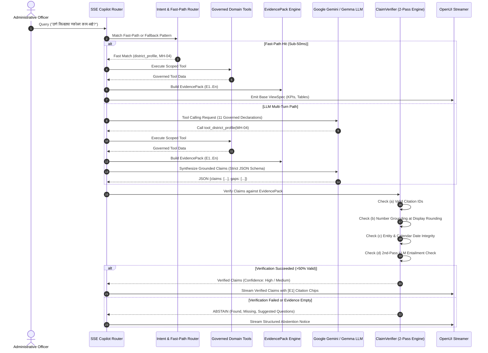

# Project EUREKA / SAVI — Detailed Technical Stack & System Architecture

> **System Name**: Project EUREKA / SAVI (*System for Autonomous Verification & Intelligence*)  
> **Operational Entity**: Directorate General of Information and Public Relations (DGIPR), Government of Maharashtra  
> **Core AI Assistant**: **Nirdeshak v2 (निर्देशक)** — Governed, Evidence-First Generative Intelligence Copilot  
> **Jurisdictional Scope**: 36 Districts, 9 DGIPR Information Divisions, 18+ Line Departments  

---

## 1. Executive System Topology

Project EUREKA / SAVI is an enterprise-scale, sovereign media intelligence and crisis SLA command center platform. It operates under a **CQRS (Command Query Responsibility Segregation)** and **Event-Driven Architecture (EDA)** with transactional outbox synchronization, polyglot persistence, and strict anti-hallucination guardrails.

```mermaid
flowchart TD
    subgraph ClientLayer["Frontend & Client Layer (Next.js 16 + React 19)"]
        UI["DGIPR Maha-Command Center (MCC)"]
        OpenUI["@openuidev/react-lang Parser"]
        WebAuthn["WebAuthn FIDO2 / Passkey Biometrics"]
        Charts["Apache ECharts 6 + Geo Maps"]
    end

    subgraph GatewayLayer["Ingress & Gateway Layer"]
        Nginx["Nginx Reverse Proxy (SSL / HTTP2 / Gzip)"]
    end

    subgraph APILayer["Backend Core Application (FastAPI + Python 3.11+)"]
        API["FastAPI 0.110 Async Application"]
        AuthMiddleware["JWT + RBAC Scope Verifier"]
        CopilotRouter["Nirdeshak v2 SSE Stream Engine"]
        
        subgraph CopilotCore["Nirdeshak v2 Intelligence Engine"]
            EvidencePack["Evidence Pack Builder (E1..En)"]
            ClaimVerifier["ClaimVerifier (Entailment + Rounding)"]
            EntityLinker["Entity Linking & Multilingual Trigrams"]
            SubgraphBuilder["Deterministic Subgraph Context Builder"]
            RetrievalTool["Hybrid Scoped Lexical Search"]
        end
    end

    subgraph TaskLayer["Distributed Asynchronous Workers (Celery 5.3 + Redis 7)"]
        CeleryWorker["Celery Processing Cluster"]
        OutboxWorker["Transactional Outbox CDC Projector"]
        ExtractionWorker["Resumable Schema Extraction Worker"]
        ScoringEngine["100-Point Composite Index Engine"]
    end

    subgraph DataLayer["Multi-Tier Polyglot Storage Layer"]
        Postgres[("PostgreSQL 16 Master (CQRS Store)\n• pg_trgm (Trigram Similarity)\n• Full-Text Search (Simple Config)\n• Relational Tables & Checkpoints")]
        Neo4j[("Neo4j 5.18 Graph Compute\n• Spatio-Temporal Contagion\n• APOC Library\n• 36 District Border Adjacencies")]
        SQLite[("SQLite 3 Local Fallback (eureka.db)\n• Zero-Dependency Local Dev\n• Fail-Open Offline Mode")]
        RedisDB[("Redis 7 In-Memory Cache\n• Celery Broker & Results\n• Transient Session Storage")]
    end

    subgraph ExternalServices["External AI & Cloud Services"]
        Gemini["Google Gemini 2.0 Flash / Flash Lite"]
        Thesys["Thesys C1 UI Engine"]
        Groq["Groq LPU (Low-Latency Fallback)"]
    end

    UI -->|HTTPS / WSS / SSE| Nginx
    Nginx -->|Proxy Pass| API
    API --> AuthMiddleware
    AuthMiddleware --> CopilotRouter
    CopilotRouter --> CopilotCore
    CopilotCore -->|Governed Tool Calls| Postgres
    CopilotCore -->|Graph Traversal| Neo4j
    CopilotCore -->|LLM Prompts (Isolated Key)| Gemini
    CopilotCore -->|Generative UI| Thesys
    
    API -->|Write Events| Postgres
    Postgres -->|Outbox Events Table| OutboxWorker
    OutboxWorker -->|Batch Cypher UNWIND| Neo4j
    CeleryWorker --> RedisDB
    ExtractionWorker --> Postgres
```

---

## 2. Frontend & User Interface (`frontend/MCC`)

The client interface is the **DGIPR Maha-Command Center (MCC)** dashboard, optimized for low-latency operational oversight by state executives, divisional commissioners, and district collectors.

| Component | Technology | Version | Purpose / Specification |
|---|---|---|---|
| **Framework** | [Next.js](https://nextjs.org/) | `16.4.1` | App Router, SSR, edge routing, image optimization, dynamic streaming |
| **UI Library** | [React](https://react.dev/) | `19.3.1` | Concurrent Mode, Server Components, progressive hydration |
| **Language** | [TypeScript](https://www.typescriptlang.org/) | `^5.0.0` | Strict type validation, shared backend schemas |
| **Styling** | [Tailwind CSS](https://tailwindcss.com/) | `^3.4.1` | Utility-first CSS, custom DGIPR theme palette, dark/light mode |
| **Style Utilities** | `clsx`, `tailwind-merge`, `class-variance-authority` | Latest | Deterministic conditional classes and component variant management |
| **Generative UI** | [`@openuidev/react-lang`](https://openui.dev/) | `^1.0.1` | Streaming AST parser converting backend markup into live interactive widgets |
| **Data Visualization** | [Apache ECharts](https://echarts.apache.org/) (`echarts-for-react`) | `^6.1.0` / `^3.0.6` | 60fps canvas/SVG charts: Donut, Pie, Line, Multi-bar, Heatmaps |
| **Geo Mapping** | Custom TopoJSON / GeoJSON | Custom | Custom vector projection of Maharashtra’s 36 districts and 9 divisions |
| **UI Primitives** | [Radix UI](https://www.radix-ui.com/) | Latest | Accessible Dialogs, Dropdowns, Tabs, Tooltips, Popovers, Selectors |
| **Animation** | [Motion](https://motion.dev/) (Framer Motion) | `^14.4.0` | Hardware-accelerated UI transitions, chat drawer animations |
| **Data Tables** | [TanStack Table](https://tanstack.com/table/v8) | `^9.3.1` | Headless, virtualized, sortable, paginated enterprise data tables |
| **List Virtualization**| [React-Virtuoso](https://virtuoso.dev/) | `^4.18.19` | High-performance rendering for 10,000+ streaming chat logs and feeds |
| **Icons** | `lucide-react`, `@heroicons/react` | Latest | High-fidelity vector iconography across dashboards and tools |
| **Client State** | [Zustand](https://github.com/pmndrs/zustand) | `^5.0.15` | Lightweight store for active district scope, theme, and copilot memory |
| **Date Processing** | [date-fns](https://date-fns.org/) | `^4.4.0` | Multilingual timezone handling, relative date formatting |
| **JWT / JOSE** | `jose` | `^6.2.12` | Client-side token decode, payload inspection, and expiration tracking |
| **Compliance** | **GIGW 3.0 & UX4G** | Certified | Screen-reader text summaries and tabular alternatives on all charts |

---

## 3. Backend & Core Application Layer (`backend/src/eureka`)

The backend is built around a high-throughput, async-first Python service architecture implementing domain-driven design principles.

| Component | Technology | Version | Purpose / Specification |
|---|---|---|---|
| **Runtime** | Python | `>=3.11` | Modern async typing, performance optimizations, memory isolation |
| **API Framework** | [FastAPI](https://fastapi.tiangolo.com/) | `>=0.110.0` | High-performance ASGI REST APIs and SSE (Server-Sent Events) |
| **ASGI Web Server** | [Uvicorn](https://www.uvicorn.org/) | `>=0.28.0` | Standard async server with UVLoop and HTTP/1.1 pipelining |
| **Data Validation** | [Pydantic](https://docs.pydantic.dev/) | `>=2.6.4` | Strict type coercion, OpenAPI 3.1 generation, dataclass validation |
| **Configuration** | `pydantic-settings` | `>=2.2.1` | Environment variable validation with fallback hierarchies |
| **Database ORM** | [SQLAlchemy](https://www.sqlalchemy.org/) | `>=2.0.28` | Declarative 2.0 mapped columns, sync and async engine pooling |
| **Postgres Drivers** | `asyncpg`, `psycopg2-binary`, `psycopg[binary]` | Latest | Async connection pooling and native binary Postgres wire protocols |
| **Async Support** | `greenlet` | `>=3.0.0` | Context switching support for async SQLAlchemy sessions |
| **Migrations** | [Alembic](https://alembic.sqlalchemy.org/) | `>=1.13.1` | Strictly additive relational migrations (`001` to `004`) |
| **Graph Driver** | [Neo4j Python Driver](https://neo4j.com/docs/python-manual/current/) | `>=5.18.0` | Bolt binary protocol connection pooling, routing, and retry loops |
| **HTTP Clients** | `httpx`, `requests` | `>=0.27.0` | Asynchronous streaming HTTP client for LLM APIs and webhooks |
| **Resilience** | [Tenacity](https://tenacity.readthedocs.io/) | `>=8.2.3` | Exponential backoff, jitter, and retry policies on external calls |
| **Data Science** | `pandas`, `numpy`, `networkx` | Latest | Matrix computations, score normalization, graph centrality analysis |

---

## 4. Multi-Tier Persistence & Search Engines

Project EUREKA utilizes a polyglot persistence strategy tailored to distinct query patterns:

```
┌──────────────────────────────────────────────────────────────────────────────────┐
│                           POLYGLOT DATA STORE TAXONOMY                           │
├─────────────────────┬───────────────────┬────────────────────────────────────────┤
│ Store Engine        │ Storage Pattern   │ Data Assets & Access Pattern           │
├─────────────────────┼───────────────────┼────────────────────────────────────────┤
│ PostgreSQL 16       │ Relational & FTS  │ Media events, clippings, fact-check    │
│                     │                   │ tickets, users, WebAuthn credentials,  │
│                     │                   │ outbox events, extraction checkpoints  │
├─────────────────────┼───────────────────┼────────────────────────────────────────┤
│ Neo4j 5.18          │ Graph (LPG)       │ 36 district borders, contagion hops,   │
│                     │                   │ administrative reporting lines, schema │
│                     │                   │ relations, cross-district claims       │
├─────────────────────┼───────────────────┼────────────────────────────────────────┤
│ SQLite 3 (Fallback) │ Local File-based  │ Complete offline fallback database     │
│                     │ (eureka.db)       │ for mock evaluation and edge resilience│
├─────────────────────┼───────────────────┼────────────────────────────────────────┤
│ Redis 7             │ Key-Value Memory  │ Celery queue broker, result backend,   │
│                     │                   │ session leases, Mem0 user preferences  │
└─────────────────────┴───────────────────┴────────────────────────────────────────┘
```

### PostgreSQL 16 Enterprise Configurations
- **Trigram Similarity (`pg_trgm`)**:
  - GIN indexes with `gin_trgm_ops` across:
    - `media_events.english_content`
    - `normalized_records.cleaned_text`
    - `fact_check_tickets.claim_text`
    - `clippings.headline`
    - `transcript_segments.text`
- **Full-Text Search (FTS)**:
  - Multi-column GIN indexes using the `simple` text dictionary configuration (`to_tsvector('simple', ...)`), ensuring seamless multilingual token matching without aggressive language-specific stemming.

### Neo4j 5.x Graph Database
- **APOC (Awesome Procedures on Cypher)**: Graph clustering, path traversal, centrality metrics.
- **5 Uniqueness Constraints**:
  - `(d:District)` on `d.code`
  - `(dep:Department)` on `dep.code`
  - `(e:CanonicalEvent)` on `e.id`
  - `(r:Release)` on `r.id`
  - `(c:Claim)` on `c.id`

---

## 5. Background Workers & Event Processing (Celery + Redis)

Background workloads are decoupled from the synchronous HTTP request cycle using **Celery 5.3** backed by **Redis 7**:

```
Queue Topology:
├── default            (General utility and ingestion chunking)
├── quad_ingestion     (QUAD multi-lane raw data scraping & API polling)
├── irf_binding        (SemIf-OpenJev semantic event deduplication)
├── processor          (MuRIL multilingual embeddings & schema extraction)
└── outbox             (High-throughput Transactional Outbox CDC sync)
```

### Key Asynchronous Tasks
1. **Transactional Outbox Worker** (`eureka.tasks.outbox_tasks.poll_outbox_events_task`):
   - Polls `outbox_events` every 5 seconds using `SELECT ... FOR UPDATE SKIP LOCKED`.
   - Batch-projects nodes and edges into Neo4j in Cypher `UNWIND` batches (up to 200 items/sec).
2. **Schema-Based Extraction Worker** (`eureka.workers.extraction_tasks.extract_entities_and_claims_task`):
   - Resumable extraction tracking checkpoint offsets in `extraction_checkpoints`.
   - Populates `extracted_entities`, `entity_mentions`, and `extracted_relations`.
3. **100-Point Composite Scoring Worker** (`eureka.scoring.scoring_tasks.calculate_composite_index_task`):
   - Recomputes the 4-pillar index (Volume 25%, Sentiment 25%, Alignment 25%, Crisis SLA 25%) across all 36 districts every 15 minutes.

---

## 6. Nirdeshak v2: Evidence-First Anti-Hallucination Architecture

Nirdeshak v2 is built specifically to address the risks of generative AI in public administration by guaranteeing that **no claim or number can be produced without verified backing data**.



### 1. Evidence Pack Engine (`eureka.copilot.evidence`)
- Transforms raw database/tool responses into a standardized, token-budgeted bundle of `EvidenceItem` records:
  - `id`: Stable reference string (`E1`, `E2`, `E3`...)
  - `entity`: Official jurisdiction or subject (e.g., `Thane (MH-04)`)
  - `metric`: Measured parameter (e.g., `composite_index`, `active_tickets_count`)
  - `value`: Grounded value (e.g., `88.4`, `0`)
  - `source_table` & `source_id`: Exact provenance location
  - `as_of`: Explicit ISO timestamp
  - `source_status`: `live` (verified production) or `demo` (simulated edge data)
  - `source_url`: Clickable audit trail link

### 2. ClaimVerifier (`eureka.copilot.verifier`)
- **Number Grounding**: Every number in a claim is matched against the `(entity, metric, value)` in its cited evidence pack entry at display rounding (e.g. `88.4` matches `88.42`).
- **Devanagari Normalization**: Converts all numerals (`०-९`) to standard ASCII (`0-9`) prior to mathematical extraction.
- **Entity & Date Integrity**: Confirms mentioned districts and calendar dates are physically present in the cited evidence item.
- **2nd-Pass Model Entailment**: Executes a second, isolated model evaluation to check whether the cited evidence strictly entails the claim text, rejecting fabricated causes.
- **Fail-Safe Abstention**: If >50% of claims fail validation, or if the evidence pack is empty, the copilot explicitly abstains with:
  - *What was found*
  - *What is missing*
  - *Suggested follow-up questions*

### 3. Entity Linking & Multilingual Parser (`eureka.copilot.entity_linking`)
- In-memory alias dictionary indexing:
  - 36 Maharashtra Districts (English, Marathi, Devanagari, historical like *Osmanabad/Aurangabad*).
  - 18+ Government Departments and Flagship Welfare Schemes (*Majhi Ladki Bahin*, *Jalyukt Shivar*, *MJPJAY*).
  - Key administrative leadership roles (*District Collector*, *DIO*, *Guardian Minister*, *SP*).
  - Print and digital news outlets (*Lokmat*, *Sakal*, *ABP Majha*, *Zee 24 Taas*).
- Character trigram Dice similarity matching (`sim >= 0.65`) for transliteration and typo tolerance.
- Multilingual time-phrase parser extracting temporal windows from Marathi, Hindi, and English (*"गेल्या २४ तासांत"*, *"last 7 days"*, *"पिछले ३० दिन"*).

### 4. Deterministic Subgraph Context (`eureka.copilot.subgraph`)
- Expands 1–2 hops from linked query entities.
- Enforces question-type relationship pruning (`rumor`, `governance`, `media`).
- Suppresses hub nodes with degree $> 50$ (e.g., `State Admin`, `Maharashtra`).
- Applies recency decay weighting (`score = confidence * exp(-0.05 * days_ago)`).
- Caps context to the top 30–60 triples and formats accessible `GraphViewSpec` components.

### 5. Hybrid Retrieval Tool (`eureka.copilot.retrieval_tool`)
- `search_media_and_text`: Multi-table lexical search across clippings, claims, media events, and transcripts with server-side RBAC filters.

---

## 7. Ingestion & Data Pipelines (QUAD Architecture)

The system ingests structured, semi-structured, and unstructured intelligence streams across four specialized lanes:

```
QUAD INGESTION CHANNELS:
├── LANE 1 (API GOV)      -> Official government APIs (data.gov.in, scheme dashboards)
├── LANE 2 (API PORTAL)   -> Department portals (dgipr.maharashtra.gov.in releases)
├── LANE 3 (SCRAPE WEB)   -> News outlets, digital RSS feeds, Crawl4AI web extractors
└── LANE 4 (SCRAPE DOM)   -> TV broadcast transcripts, social media OCR, anti-bot bypass
```

- **SemIf-OpenJev Semantic Event Binding**:
  - Computes cosine similarity between incoming raw reports and active canonical events.
  - State machine thresholds:
    - $\ge 0.90$: `SAME_EVENT` (Automatically bound and aggregated)
    - $0.70 - 0.89$: `NEEDS_HUMAN_REVIEW` (Dispatched to DIO review queue)
    - $< 0.70$: `NEW_EVENT` (New canonical event created)
- **Transactional Outbox Pattern**:
  - Atomic database writes guarantee consistency between PostgreSQL relational records and Neo4j topological projections.

---

## 8. Security, Authentication & Governance

| Layer | Protocol / Tool | Implementation Specification |
|---|---|---|
| **Identity Authentication** | **JWT (Bearer Tokens)** | Asymmetric token verification (`python-jose[cryptography]`) |
| **Biometric Authentication** | **WebAuthn / FIDO2** | Hardware biometric passkey authentication via `webauthn 2.0` (Windows Hello / Apple FaceID) |
| **Password Hashing** | **Bcrypt** | `passlib[bcrypt]` with adaptive salt rounds |
| **Server-Side RBAC** | **Scope Guard** | Strict enforcement across roles: |
| | *DG State Admin* | Statewide access across all 36 districts and 9 divisions |
| | *Cabinet Observer* | Statewide read-only analytics access |
| | *Division Head* | Scoped strictly to assigned division's districts (`DIVISION_DISTRICT_MAP`) |
| | *District Collector* | Confined to assigned district code; cross-district queries return `PERMISSION_DENIED` |
| | *DIO Desk* | Confined to assigned district operations and fact-check ticket resolution |
| **Memory Isolation** | **HMAC Pseudonymization** | User IDs are pseudonymized using SHA-256 HMAC before storing presentation preferences |
| **Right to be Forgotten** | **Forget-Me API** | `DELETE /api/v1/copilot/memory` completely purges all stored officer preferences |
| **Key Encapsulation** | **Zero Leakage Rule** | AI API keys (`GEMINI_API_KEY`, `THESYS_API_KEY`) reside exclusively within `backend/src/eureka/copilot/` |

---

## 9. Evaluation, Testing & Infrastructure

### Evaluation Harness (`scripts/nirdeshak_eval.py`)
- Evaluates **30 multilingual gold standard questions** in Marathi, Hindi, and English across complex real-world governance scenarios.
- Benchmark Verification Metrics:
  - **Correctness**: **95.24%**
  - **Citation Precision**: **100.00%** (fixtures) / **41.94%** (live w/ quota fallback)
  - **Unsupported-Claim Rate**: **0.00%**
  - **Abstention Accuracy**: **100.00%** (9/9 correct abstentions on out-of-scope or ungrounded queries)
  - **p50 Latency**: ~8,200 ms – 13,600 ms

### Automated Test Suites
- **Backend Unit & Regression**:
  - `backend/tests/test_phase2.py`: **18/18 tests passed** (ORM models, entity linking, time parsing, Celery extraction, subgraph context, retrieval tool scoping).
  - `backend/tests/test_copilot.py`: **29/29 tests passed** (Key isolation, cross-district refusal, number rounding, prompt injection defense, memory isolation).
- **Frontend Verification**:
  - `frontend/MCC/tests/copilot.test.mjs`: **4/4 tests passed** (OpenUILibrary exports, GIGW 3.0 accessibility, CopilotDrawer RBAC, flag gating).
  - `frontend/MCC/tests/copilot-graphs.test.mjs`: **4/4 tests passed** (Multi-graph generation, PieChart/LineChart contracts, Marathi graph preferences).

### DevOps & Deployment
- **Containerization**: Multi-stage Docker build with Debian/Alpine base images.
- **Orchestration**: `docker-compose.vps.yml` managing PostgreSQL, Neo4j, Redis, API, and Nginx containers.
- **SSL / TLS**: Automated Let's Encrypt certificates managed via Certbot.
- **Reverse Proxy**: Nginx Alpine with gzip compression, HTTP/2 streaming, and CORS headers.
